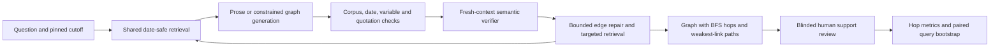

# Does Grounding Decay with Distance?

Measuring and repairing weak links in LLM causal explanations of Indian macroeconomic news.

LMA Group Project 2026 — Varun Patil (2025204013), Harshal Bhansali (2026909007),
Deepti Koranga (2025204033).

---

## What this is

Given a question like *"Brent crossed $100 on 12 March 2026; what effects on India were
sources discussing?"*, the system answers with an **event-impact graph** rather than prose.
Every edge in that graph carries two labels:

- **provenance** — `source_asserted` (a passage published on or before the as-of date states
  this relation, and we hold the verbatim span) or `model_inferred` (no supporting passage was
  found; the link is the model's own reasoning);
- **strength** — `direct`, `conditional` or `correlational`.

A path is scored by its **weakest hop**. That makes it visible where a fluent explanation stops
being grounded, which is the thing we measure: does the unsupported-edge rate rise with hop
distance from the anchor event, and can edge-targeted verification and retrieval repair it?

Primary metric is **UER** (unsupported established-edge rate), always sliced by hop 1 / 2 / ≥3.

## Status

**Development pipeline integrated; research acceptance is incomplete.** The local
snapshot contains 1,173 documents and 27,286 passages. Retrieval, constrained
extraction, independent rule/LLM verification, six bounded read-only tools, the
controller and all seven conditions are implemented. B0/B1/B1-R produce prose
before mechanical edge extraction. Human correction and blinded support review
remain required. Three of six macro series are populated, including partial
Indian basket coverage.

The local Qwen3-8B run uses pinned public weights and no paid API. It is an
integration model, not the result of the still-pending two-model selection pilot.
The six source-backed queries in `data/eval/development_candidates.jsonl` are
unreviewed candidates, not the frozen development gold set. See
[docs/reproduction.md](docs/reproduction.md), [PLAN_MIDSUB.md](PLAN_MIDSUB.md),
and [docs/decisions.md](docs/decisions.md).



## Quick start

```bash
make setup     # .venv on Python 3.12, project + dev tools, via uv
make test      # pytest: round-trips every model, validates every fixture
make lint      # ruff + black --check
make hooks     # one-off: install the pre-commit hooks
```

`make setup` needs [uv](https://docs.astral.sh/uv/). If you do not have it:
`python3 -m pip install --user uv`, or `curl -LsSf https://astral.sh/uv/install.sh | sh`.
uv fetches Python 3.12 itself, so you do not need it installed system-wide.

## Directory map

One owner per directory for the whole 11 days — that is the merge-conflict map, not a
suggestion. Do not edit another track's directory; open an issue instead.

| Path | Track | What lives there |
|---|---|---|
| `scripts/fetch/` | A | Collectors for the four publications and the official documents |
| `src/corpus/` | A | Parsing, normalising, near-dup removal, chunking with char offsets |
| `src/retrieval/` | A | BM25, embeddings, hybrid RRF, the reranker |
| `data/raw/`, `data/processed/`, `data/series/` | A | Corpus payload, manifest, macro series |
| `src/schema/` | B | **This package.** Frozen records + the closed ontology |
| `src/extract/` | B | Event and candidate-edge extraction, JSON-constrained |
| `src/verify/` | B | Rule layer, LLM verifier, weakest-link path labelling |
| `data/eval/` | B | Queries, gold graphs, challenge set, agent states, safety prompts |
| `src/llm/` | C | One `generate()` over MLX / llama.cpp / vLLM / API |
| `src/tools/` | C | The six read-only tools |
| `src/agent/` | C | Controller, state, priority policy, budget |
| `src/conditions/` | C | Seven conditions as config flags over one code path |
| `src/eval/` | C | Metrics, bootstrap, safety eval |
| `configs/`, `notebooks/`, repo infra | C | |

## The frozen records

All five live in `src/schema/` and are exported as JSON Schema to `docs/schemas/`
(regenerate with `make schemas`; a test fails if they drift from the models).

| Record | Module | Notes |
|---|---|---|
| `Passage` | `schema.models` | Paragraph + char offsets into the document text |
| `Edge` | `schema.models` | provenance, strength, direction, evidence span, hop |
| `Graph` | `schema.models` | query_id, anchor, as_of, nodes, edges, paths |
| `ToolCall` / `ToolResult` | `schema.tools` | Discriminated unions, one variant per tool |
| `RunLogLine` | `schema.runlog` | One JSONL line per model call / tool call / state |

```python
from schema import Edge, Graph, Passage, load_ontology, parse_tool_call

load_ontology().ids()          # the closed list of 46 macro variables
Edge(...)                      # rejects an asserted edge with no evidence span
```

Three invariants the models enforce, because the metrics depend on them:

1. A `Passage`'s char offsets must match its own text, or verbatim-span checking drifts.
2. A `source_asserted` `Edge` must carry an evidence span and a document id.
3. A `Graph`'s `hop` labels must match breadth-first distance from the anchor, and a `Path`'s
   `weakest_strength` must equal minimum aggregation over its edges.

## Experimental conditions

Seven conditions, **one code path**, config flags only (`src/conditions/`, `configs/*.yaml`):
`B0` closed-book · `B1` standard RAG · `B1-R` RAG + reranker · `B2` RAG + self-labels ·
`A-NoVerify` · `A-NoLoop` · `M` full system.

## Corpus

Indian macro-financial news (BusinessLine, Economic Times, Business Standard, Mint) plus
RBI / MOSPI / PPAC / PIB documents, **1 March – 30 September 2026**, frozen. The window is
enforced in the `Passage` model. Macro series only confirm that a move happened; they are
never evidence for an edge.

The corpus payload is not in git — see `.gitignore` and `data/processed/MANIFEST.md`.

## Contributing

Branch and PR rules are in [CONTRIBUTING.md](CONTRIBUTING.md). Short version: `main` is
protected, branch as `a/`, `b/` or `c/<slug>`, one review, merge the same day, commit daily.
