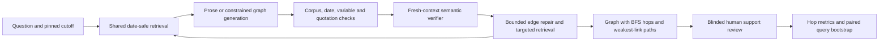

# Does Grounding Decay with Distance?

Measuring and repairing weak links in LLM causal explanations of Indian macroeconomic news.

LMA Group Project 2026 — Varun Patil (2025204013), Harshal Bhansali (2026909007),
Deepti Koranga (2025204033).

---

## Latest Track A delivery — 28 October 2026

**Fresh-checkout update — 28 October:** Track A / Varun task 4.3 is complete
for the local development configuration. A clean GitHub checkout passed setup,
Ruff/Black and **663 tests with no skips**, then generated **24/24 new graphs**
(B0/B1/B2/M × six current-v7 candidates). Full audit, independent trace checks
and unchanged resume (24 cached, no new model calls) passed. Cached model weights,
native inference environments and the verified PDF distribution were reused;
other laptops/Kaggle remain unverified. See
[fresh-checkout evidence](reports/fresh_checkout_reproduction_20261028.md).

**Integration fixes:** all five audited code gaps are repaired: new runs use the
selected BGE-M3 retriever, anchor checks call the series store, resume binds all
participating code/data/settings, run validation requires the declared sweep,
and installed verifier aliases are included. See
[the fix validation](reports/integration_fixes_20261027.md).
Shared annotation, model selection, result figures and other-machine/Kaggle
verification remain separate prerequisites. The
[original audit](reports/whole_project_audit_20261027.md) is preserved as history.

The scoped Track A mid-submission development handoff is complete. The
[closeout](reports/track_a_mid_submission_scope_20261027.md) records the reduced
source/PDF scope and sparse historical-series coverage as delivery deviations.
Varun's 27 October review and explicit independence/blinding attestations are
now recorded. Both sampled-corpus and retrieval acceptance exports pass; these
validate the records and declarations, not the unobserved review procedure.

The active **v7 narrative development** corpus contains **1,156 documents and
16,472 passages**. Missing article text, author biographies, embedded related
links and scope false positives have been addressed. Official PDFs contribute
949 coherent narrative paragraphs; table/chart fragments stay outside the text
index with their originals and layout provenance preserved.

The dense index is rebuilt. All **2,035 pooled relevance judgments** are complete
within the new pool: **195 relevant, 1,840 irrelevant**, with no unresolved labels.
The 20-question development comparison selects BGE-M3 under the declared rule;
Recall@10 is 0.4259, rising to 0.5296 with top-50 reranking. The original
comparison uses automated development judgments. Their origin is preserved
alongside Varun's subsequent user-attested review; no item decision or evidence
span has changed.

All six macro series retain their 161 dated original observations. A separate
317-observation retrospective snapshot remains excluded at historical cutoffs.
Source gaps, permissions and anchor limitations are explicitly documented.
The current suite passes **663 tests** after optional PDF/extraction dependencies
are installed; committed-source reparse reproduces the archive hash.

The new independent-review workspace is
`data/interim/track_a_review_delivery_v7_20261026/START_HERE.md`; its judgments and
attestations are blank in the saved delivery. Separate completed records now
name Varun, dated 27 October, with user-declared independence and blinding.
Schemas, packet bindings, complete coverage and exact spans pass both exporters.
The original supplied files and development-label provenance remain preserved;
identity, review conduct and timing of blinding are not independently verified.
See `reports/track_a_reviewer_identity_20261027.json`. No experiment-result
review or main hypothesis conclusion is claimed. Earlier v1 runs and
the v3 review retain their original corpus bindings. See
[Track A delivery](reports/track_a_progress.md) and
[reproduction instructions](docs/reproduction.md).


The follow-up audit checks every retained official PDF version and seven SEBI
annexures. Five total-FPI candidates remain separate because their asset coverage
differs from the current series. Dated primary announcements now support the
April ATF announcement and August RBI meeting; final anchor acceptance remains
with Track B. See [the follow-up record](reports/track_a_followup_20261026.json).

## Track C Phase 1 — completed 30 October 2026

**All eleven C1–C11 deliverables are complete on `varun`.** The agent-controller
work is merged; Claude logging, verified-strength relabelling, `verify_edge`,
Windows worker and resume/checksum portability defects are fixed.

- **Model decision:** `mlx-community/Qwen3-8B-4bit` at `545dc4251c05440727734bcd94334791f6ab0192`. Both models completed the
  same 100 project-schema pilot cases; all 200 raw scores reproduce.
- **Safety:** 25 new selected-model responses reviewed across all four risks,
  with assistant reviewer provenance and per-response reasons.
- **Kaggle:** the private two-T4 vLLM run completed all 14 graphs and cached
  all 14 on resume; measured allocation including setup was 1.211103 GPU-hours.
- **Checks:** 724 passing tests on each native Windows, Ubuntu and macOS
  runner, with no skips; Ruff and notebook-inclusive Black pass.
- **Data handoff:** the exact v7 dense index and passages are supplied in a
  separately checksummed frozen-data archive and private Kaggle dataset.

See [the C1–C11 closeout](reports/phase1_track_c_closeout_20261030.md),
[model pilot](reports/pilot_model_project_20261030.md) and
[Kaggle/Windows handoff](docs/track_c_kaggle_handoff.md).
`make validate-track-c` rechecks the saved completion evidence. Synthetic
diagnostics and assistant safety review do not establish human-reviewed research
results; full gold sweeps and headline UER remain later-phase work.

## What this is

Given a question like *"Brent crossed $100 on 12 March 2026; what effects on India were
sources discussing?"*, the system answers with an **event-impact graph** rather than prose.
Every edge in that graph carries two labels:

- **provenance** — `source_asserted` (a passage published on or before the as-of date states
  this relation, and we hold the verbatim span) or `model_inferred` (no supporting passage was
  found; the link is the model's own reasoning);
- **strength** — `direct`, `conditional` or `correlational`.

A path is scored by its **weakest hop**. That makes it visible where a fluent explanation stops
being grounded, which is the thing we measure: does the unsupported-edge rate rise with hop
distance from the anchor event, and can edge-targeted verification and retrieval repair it?

Primary metric is **UER** (unsupported established-edge rate), always sliced by hop 1 / 2 / ≥3.

## Status

**Development pipeline integrated; research acceptance is incomplete.** The local
development snapshot contains 1,156 documents and 16,472 passages. Retrieval, constrained
extraction, independent rule/LLM verification, six bounded read-only tools, the
controller and all seven conditions are implemented. B0/B1/B1-R produce prose
before mechanical edge extraction. Human correction and blinded support review
remain required. All six macro series are populated; basket, Brent, benchmark yield and FPI
coverage remain partial and do not confirm the planned anchor episodes.

The 23 October local integration completed all 42 graphs across six unreviewed
v1 candidates. The archived synthetic tool-choice probe succeeded on only 5/40
expected actions. The separate two-model project pilot now resolves D-01;
execution, model selection and structural validity do not establish research performance. See
[the validation and remaining gates](reports/integration_status.md).

Current local runs read the pinned D-01 selection from
`configs/model_selection.json`. Historical Qwen3-8B integration runs keep their
original model identity; no paid API was used.
The six source-backed queries in `data/eval/development_candidates.jsonl` are
unreviewed candidates, not the frozen development gold set. See
[docs/reproduction.md](docs/reproduction.md), [PLAN_MIDSUB.md](PLAN_MIDSUB.md),
and [docs/decisions.md](docs/decisions.md).



## Quick start

```bash
make setup     # .venv on Python 3.12, project + dev tools, via uv
make test      # pytest: round-trips every model, validates every fixture
make lint      # ruff + black --check
make hooks     # one-off: install the pre-commit hooks
```

`make setup` needs [uv](https://docs.astral.sh/uv/). If you do not have it:
`python3 -m pip install --user uv`, or `curl -LsSf https://astral.sh/uv/install.sh | sh`.
uv fetches Python 3.12 itself, so you do not need it installed system-wide.

## Directory map

One owner per directory for the whole 11 days — that is the merge-conflict map, not a
suggestion. Do not edit another track's directory; open an issue instead.

| Path | Track | What lives there |
|---|---|---|
| `scripts/fetch/` | A | Collectors for the four publications and the official documents |
| `src/corpus/` | A | Parsing, normalising, near-dup removal, chunking with char offsets |
| `src/retrieval/` | A | BM25, embeddings, hybrid RRF, the reranker |
| `data/raw/`, `data/processed/`, `data/series/` | A | Corpus payload, manifest, macro series |
| `src/schema/` | B | **This package.** Frozen records + the closed ontology |
| `src/extract/` | B | Event and candidate-edge extraction, JSON-constrained |
| `src/verify/` | B | Rule layer, LLM verifier, weakest-link path labelling |
| `data/eval/` | B | Queries, gold graphs, challenge set, agent states, safety prompts |
| `src/llm/` | C | One `generate()` over MLX / llama.cpp / vLLM / API |
| `src/tools/` | C | The six read-only tools |
| `src/agent/` | C | Controller, state, priority policy, budget |
| `src/conditions/` | C | Seven conditions as config flags over one code path |
| `src/eval/` | C | Metrics, bootstrap, safety eval |
| `configs/`, `notebooks/`, repo infra | C | |

## The frozen records

All five live in `src/schema/` and are exported as JSON Schema to `docs/schemas/`
(regenerate with `make schemas`; a test fails if they drift from the models).

| Record | Module | Notes |
|---|---|---|
| `Passage` | `schema.models` | Paragraph + char offsets into the document text |
| `Edge` | `schema.models` | provenance, strength, direction, evidence span, hop |
| `Graph` | `schema.models` | query_id, anchor, as_of, nodes, edges, paths |
| `ToolCall` / `ToolResult` | `schema.tools` | Discriminated unions, one variant per tool |
| `RunLogLine` | `schema.runlog` | One JSONL line per model call / tool call / state |

```python
from schema import Edge, Graph, Passage, load_ontology, parse_tool_call

load_ontology().ids()          # the closed list of 46 macro variables
Edge(...)                      # rejects an asserted edge with no evidence span
```

Three invariants the models enforce, because the metrics depend on them:

1. A `Passage`'s char offsets must match its own text, or verbatim-span checking drifts.
2. A `source_asserted` `Edge` must carry an evidence span and a document id.
3. A `Graph`'s `hop` labels must match breadth-first distance from the anchor, and a `Path`'s
   `weakest_strength` must equal minimum aggregation over its edges.

## Experimental conditions

Seven conditions, **one code path**, config flags only (`src/conditions/`, `configs/*.yaml`):
`B0` closed-book · `B1` standard RAG · `B1-R` RAG + reranker · `B2` RAG + self-labels ·
`A-NoVerify` · `A-NoLoop` · `M` full system.

## Corpus

Indian macro-financial news (BusinessLine, Economic Times, Business Standard, Mint) plus
RBI / MOSPI / PPAC / PIB documents are the planned sources, **1 March – 30 September
2026**. The current development snapshot contains ET, BusinessLine, Mint, MoSPI,
PPAC and OEA; Business Standard and RBI remain absent. The window is
enforced in the `Passage` model. Macro series only confirm that a move happened; they are
never evidence for an edge.

The corpus payload is not in git — see `.gitignore` and `data/processed/MANIFEST.md`.

## Contributing

Branch and PR rules are in [CONTRIBUTING.md](CONTRIBUTING.md). Short version: `main` is
protected, branch as `a/`, `b/` or `c/<slug>`, one review, merge the same day, commit daily.
