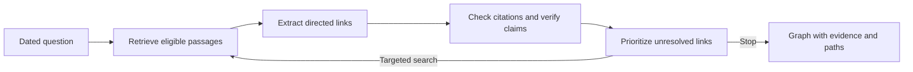

# Does Grounding Decay with Distance?

**Can a language model explain a chain of economic effects without overstating what its sources say?** We study that question using Indian macro-financial news. The full system answers a dated question with an **event-impact graph**. Each link records the direction of the effect, its strength, and the source passage when one supports it.

Language Models & Agents group project, 2026 · Varun Patil, Harshal Bhansali and Deepti Koranga

[Final report (PDF)](reports/final_project_report.pdf) · [Reproduction guide](docs/reproduction.md) · [Implementation and evidence map](docs/submission_verification.md) · [Original proposal](proposal_lma.pdf)

## What the project does

Consider the question “After Brent crossed $100 in March 2026, what effects on India did sources discuss?” A passage might support a link from crude prices to fuel costs while leaving the next link to airfares unsupported. The system keeps those links distinct so a reader can inspect where the evidence ends.



- **Retrieval.** BGE-M3 searches a frozen corpus using the query's publication cutoff. A baseline adds a cross-encoder over the top 50 candidates to test how much better ranking alone helps.
- **Verification.** Rules check the passage ID, date, variable mentions, and verbatim quote. A semantic verifier then checks whether the source supports the claimed direction and strength.
- **Controller.** The controller searches for evidence on unresolved links within a 12-call budget. The graph labels supported and inferred links separately and records each path's weakest link.
- **Evaluation.** The study measures unsupported established-edge rate (UER), strength inflation, and recall of adjudicated reference edges. It compares conditions on the same queries and inspects errors at hops 1, 2, and 3+ from the event.

## Data and experiments

The frozen corpus spans **March–September 2026** and contains **1,156 documents and 16,472 passages**. Six dated macro series supply 161 observations to check whether an event occurred. The causal evidence comes from passages. The signed reference set covers four development queries and two held-out queries from one foreign portfolio investment episode. The study also includes a 130-item corruption challenge and public causal-language benchmarks.

| Condition | What it tests |
| --- | --- |
| `B0` | Query-only baseline without text retrieval |
| `B1` | Standard RAG with cited prose |
| `B1-R` | Standard RAG with a cross-encoder reranker |
| `B2` | RAG prompted to supply provenance and strength labels |
| `A-NoVerify` | Full system with generator self-labels in place of semantic verification |
| `A-NoLoop` | Full system with initial retrieval and no targeted search loop |
| `M` | Full graph, semantic verifier, and bounded search loop |

All seven conditions ran on four development queries with **Qwen3-8B** and again with **Qwen3.5-9B** for sensitivity. The primary model also ran all seven conditions on both held-out queries. See the [development sweep audit](reports/dev_gold_sweeps_20261110.md) and [held-out audit](reports/heldout_generation_20261112.md).

## What we found

These are paired results for the full system **M** minus standard RAG **B1**, using the revised support judgments. Each metric uses the query pairs with a defined score for both systems.

| Split | UER change | Reference-edge recall change |
| --- | ---: | ---: |
| Primary development | −16.7 pp (3 pairs) | +6.25 pp (4 pairs) |
| Sensitivity development | −25.0 pp (2 pairs) | 0.0 pp (4 pairs) |
| Primary held-out | 0.0 pp (2 pairs) | −12.5 pp (2 pairs) |

The held-out recall loss exceeded the prespecified 10-point limit. In the separate corruption challenge, the semantic verifier caught **17 of 38** direction or strength corruptions that passed the citation rules and flagged **2 of 23** clean controls. The held-out sample covers one episode, and the development runs yielded too few deep-hop links to assess grounding decay. [Final report, §§7–9](reports/final_project_report.pdf) · [Verifier challenge results](reports/challenge_model_arm.md)

## Run locally

### Install and test

The core suite and synthetic pipeline check run with Python 3.12 and [uv](https://docs.astral.sh/uv/). They require no model weights, research corpus, or GPU.

```sh
git clone --branch b/episode-confirmation https://github.com/DeeptiKoranga/lma-grounding-decay.git
cd lma-grounding-decay
uv sync --frozen --extra dev
uv run --no-sync pytest
PYTHONPATH=src uv run --no-sync python -m scripts.run_fixture_check --output runs/fixture-check
```

The fixture check runs all seven conditions and writes graphs, tool logs, and a local viewer. Choose a fresh output directory for each run.

### Reproduce the research

The research sweeps need the **frozen corpus, matching dense index, pinned model weights, and backend environment**. Follow the [reproduction guide](docs/reproduction.md) and check the corpus against its [manifest](data/processed/MANIFEST.md). The article payload, model caches, and raw run outputs are kept outside Git.

| Goal | Entry point |
| --- | --- |
| Regenerate the original development RQ summaries from saved scores | `make rq` |
| Run both signed development sweeps | `make sweep-dev-both` |
| Check signed held-out inputs and run the two-query sweep | `make sweep-test-descriptive` |
| Rerun the semantic verifier challenge | `make challenge-model-arm` |
| Review and score generated graphs | [Prose correction and blind support scoring](docs/independent_review.md) |

`make rq` uses the committed historical development scores. The revised judgments and contrasts are described in Section 7.1 of the [final report](reports/final_project_report.pdf). Build the PDF with `tectonic reports/final_project_report.tex`.

## Repository map

| Path | Contents |
| --- | --- |
| [`src/corpus/`](src/corpus), [`src/retrieval/`](src/retrieval) | Corpus processing, date filters, dense retrieval, and reranking |
| [`src/schema/`](src/schema), [`src/extract/`](src/extract), [`src/verify/`](src/verify) | Graph and evidence schemas, edge extraction, verification, and path labels |
| [`src/conditions/`](src/conditions), [`src/agent/`](src/agent), [`src/tools/`](src/tools), [`src/llm/`](src/llm) | Shared runner, control policies, tool calls, and model backends |
| [`src/eval/`](src/eval), [`data/eval/`](data/eval), [`data/series/`](data/series) | Scoring, signed reference graphs, challenge inputs, and dated macro observations |
| [`configs/`](configs), [`scripts/`](scripts), [`notebooks/`](notebooks), [`tests/`](tests) | Pinned settings, commands, recorded compute workflows, and regression checks |
| [`docs/`](docs), [`reports/`](reports) | Reproduction details, design decisions, experiment audits, and report sources |

## Project records

- [Research decisions](docs/decisions.md), [mid-submission plan](PLAN_MIDSUB.md), and [academic report snapshot](reports/academic_report.pdf)
- [Track A corpus and retrieval handoff](reports/track_a_progress.md), [Track C closeout](reports/phase1_track_c_closeout_20261030.md), and [Phase 1 joint review](reports/phase1_tracks_a_c_review_20261030.md)
- [Contributing and branch review workflow](CONTRIBUTING.md)
