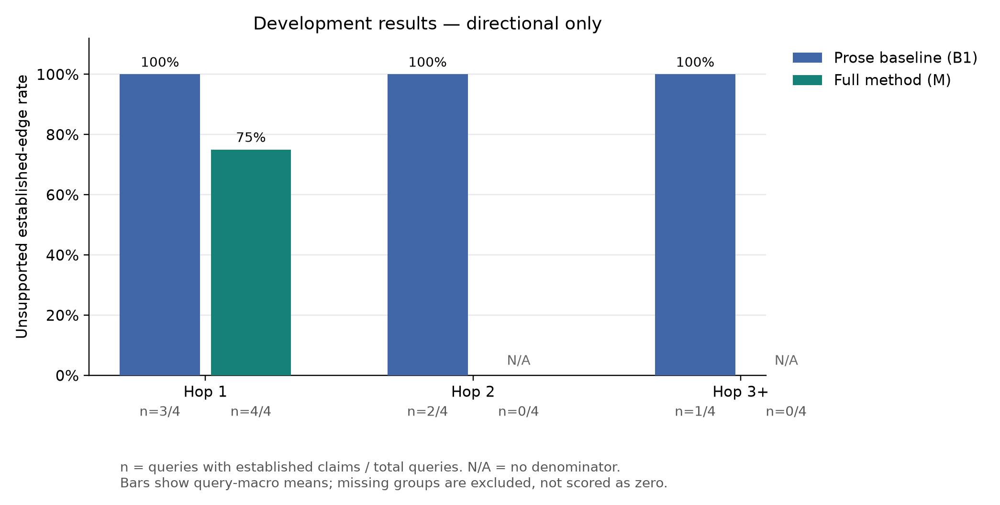

% Does Grounding Decay with Distance? Measuring and Repairing Weak Links in LLM Causal Explanations of Indian Macroeconomic News
% Varun Patil (2025204013) · Harshal Bhansali (2026909007) · Deepti Koranga (2025204033)
% Language Models & Agents (LMA) Group Project 2026 — Mid Submission Report
% GitHub: https://github.com/DeeptiKoranga/lma-grounding-decay

## 1. Introduction

Readers increasingly ask assistants to connect events reported separately in the
news: an oil shock, a weaker rupee, a central-bank decision. Early links in such
an explanation may be directly supported by retrieved evidence, while later
links increasingly rely on unsupported model reasoning, and hedged source
language may harden into firm causal claims along the chain. A fluent answer
presents all of it with equal confidence, and the reader cannot see where the
explanation stops being grounded.

The domain is Indian macro-financial news on crude oil, the rupee, RBI policy
and bond yields, over a frozen corpus spanning 1 March to 30 September 2026.

**RQ1 (phenomenon).** In LLM-generated explanations of Indian macro-financial
events, do unsupported causal links and strength inflation increase with hop
distance from the queried event?

**RQ2 (intervention).** Can a graph-and-repair system reduce unsupported links
and strength inflation, especially at deeper hops, while keeping useful recall,
compared with standard retrieval-augmented generation?

**Hypotheses.** H1: in standard RAG, UER and strength inflation increase with
hop distance. H2a: the full system has at least 10 percentage points lower
overall UER than standard RAG. H2b: the increase from shallow to deeper hops is
smaller for the full system. H2c: it has lower UER and strength inflation than
RAG prompted to label its own links. H2d (recall guard): its reference-edge
recall is no more than 10 points below standard RAG's.

H2d is not decoration. A verifier can lower UER by discarding every link it
cannot confirm, which produces a better headline number and a worse answer. The
guard is what separates repair from deletion, and Section 6 shows why that
distinction has already become the central question of the project.

## 2. Method

### 2.1 Representing an explanation as an inspectable graph

Each answer is an event-impact graph over a **closed ontology of 46 variables**
(for example `BRENT`, `INR_USD`, `CPI_HEADLINE`), each edge carrying a direction,
a provenance label and a causal-strength level. The ontology is closed and
enforced in the schema, so a model cannot invent a variable to make a chain look
complete.

| Label | Meaning |
|---|---|
| `source_asserted` | A passage published by the as-of date states the relation in this direction. Set only by the verifier. |
| `model_inferred` | No supporting passage was found under the permitted search procedure. |
| `direct` | Unhedged causal language: caused, due to, driven by. |
| `conditional` | Hedged or conditional: could, may, if, upside risk. |
| `correlational` | Co-occurrence or sequence only: amid, as, after. |

`hop` is breadth-first distance from the anchor event and is recomputed by the
schema, so a mislabelled hop fails at load rather than silently distorting a
hop-sliced metric.

### 2.2 Verification in two layers

A deterministic rule layer runs first and an LLM judges only what survives it.
The four rules are: the cited passage must be in the corpus; it must be
published on or before the as-of date; it must mention both variables (searching
the cited paragraph and the one before it, so that anaphora across a paragraph
break is not mistaken for a missing mention); and it must contain the quoted
span word for word.

Passing the rule layer means **eligible**, never **supported**. Only the LLM
verifier, in a fresh context and without the generator's reasoning, may mark an
edge `source_asserted`.

### 2.3 Agent loop and tools

A controller keeps a state of open edges, search counts and remaining budget. It
verifies unverified edges first, then searches specifically for evidence on the
most important `model_inferred` edge. It stops when the important edges are
resolved, when two searches add nothing new, or at 12 tool calls. Six tools —
`search_corpus`, `get_series`, `verify_edge`, `counter_search`, `update_graph`,
`stop` — are read-only and schema-validated, with the date filter and budget
enforced in code rather than in the prompt.

### 2.4 Conditions

Seven conditions share one model, corpus, date filter, retriever, query set and
prompt budget, and run through a single code path, so they differ by
configuration rather than by implementation.

| Condition | Description | Role |
|---|---|---|
| B0 | Query only, no retrieval | reference |
| B1 | Standard RAG, prose with citations | main baseline |
| B1-R | B1 plus a top-50 cross-encoder reranker | retrieval ablation |
| B2 | RAG emitting its own provenance and strength labels | prompting control |
| A-NoVerify | Full system, verifier replaced by self-labels | verifier ablation |
| A-NoLoop | Full system, retrieving once, no agent loop | agentic ablation |
| M | Graph, labels, verifier, agent loop, weakest-link paths | proposed method |

## 3. Experimental setup

### 3.1 Corpus

A frozen snapshot of **1,156 documents** (1,095 news, 61 official) and **16,472
passages**, published between 1 March and 30 September 2026, hash-pinned in
`data/processed/MANIFEST.md`. Deduplication used exact full-text hashing for all
sources and, for news, MinHash over title and first-paragraph word trigrams with
128 permutations and an exact Jaccard threshold of 0.85.

| Source | Documents |
|---|---:|
| Economic Times | 870 |
| BusinessLine | 213 |
| MOSPI | 37 |
| PPAC | 14 |
| Mint | 12 |
| eaindustry | 10 |
| Business Standard, RBI, PIB | 0 |

Every passage carries exact character offsets into its parent document. Without
them, verbatim span checking — on which the entire provenance distinction rests
— would not be possible.

### 3.2 Macro series

Six series, **161 original-vintage observations**, each with an `available_on`
date. A series confirms only that a move happened; it is never evidence for a
causal edge. Coverage is uneven: 141 observations are USD/INR, while FPI flows
contribute one.

### 3.3 Evaluation sets

Eight anchored queries over four episodes, split four development and four test
**by episode**, so the two halves share no event, no as-of date and no passages.
Of the four test queries only three are answerable from the frozen corpus; the
fourth names a target the corpus never connects to its anchor, which Section 7
sets out. Four reviewer evidence graphs hold 16 source-asserted edges with
verbatim spans, adjudicated by two independent annotators (Section 4.4). A challenge set holds 89
items: 16 clean controls and 73 mechanically corrupted edges across five
families. Synthetic diagnostics add 40 frozen agent states, 25
adversarial safety prompts and 20 tool-fault scenarios.

Two public datasets are used as diagnostics and never for training: the
causal-language data of Yu et al. (2019) and FinCausal 2020 task 1, 200 sampled
items each.

### 3.4 Model and compute

`mlx-community/Qwen3-8B-4bit`, revision `545dc425`, selected by the pilot in
Section 4.1. All development ran locally on an Apple M5 via MLX. A private
two-T4 Kaggle execution consumed **1.211 visible allocated GPU-hours**. **No
paid API request was made.**

## 4. Results

### 4.1 Model selection

Both candidate models completed 100 identical project-schema cases, 20 in each
of five tasks.

| Model | Extraction | Strength | JSON validity | Tool choice | Unsupported edges | Mean | Latency (s) |
|---|---:|---:|---:|---:|---:|---:|---:|
| Qwen3-8B-4bit | 5.0% | 95.0% | 100.0% | 10.0% | 95.0% | 61.0% | 20.4 |
| Qwen3.5-9B-4bit | 65.0% | 75.0% | 100.0% | 5.0% | 60.0% | 61.0% | 26.6 |

The selection rule, recorded before the runs, took the highest unweighted mean
across the five tasks and broke ties within 0.03 on latency. The means tied
exactly at 61.0%, so the faster 8B model was selected.

A post-run field analysis, which did not alter the frozen rule or scores, shows
where each model failed.

| Failure category | Qwen3-8B | Qwen3.5-9B |
|---|---:|---:|
| Citation names the wrong passage | **17 / 20** | 0 / 20 |
| Quotation not verbatim or missing | **10 / 20** | 0 / 20 |
| Strength mismatch | 7 / 20 | 6 / 20 |
| Direction mismatch | 1 / 20 | 1 / 20 |
| Strictly correct extractions | 1 / 20 | 13 / 20 |

### 4.2 Retrieval

Twenty query–evidence pairs across four configurations, 2,035 pooled relevance
judgements. The decision rule — take the simplest configuration within 0.03
Recall@10 of the best — was fixed before the comparison.

| Configuration | Recall@10 |
|---|---:|
| BM25 | 0.3518 |
| BM25 with alias expansion | 0.3551 |
| Hybrid (reciprocal rank fusion) | 0.4161 |
| BGE-M3 (selected) | 0.4259 |
| BGE-M3 with top-50 cross-encoder | 0.5296 |

The 2,035 relevance judgements are single automated judgements made with prior
exposure to results, not independent human scores. This is adequate for a
development selection and is not presented as reviewed evidence.

### 4.3 Causal strength and detection on public data

A deterministic cue classifier built from the project's own cue lists, scored on
data nobody on the project wrote. It exists to give the model arm a floor to
clear.

| Check | Result |
|---|---|
| Strength, 3-class (Yu et al.) | macro-F1 0.414, accuracy 0.350, 81/200 abstentions |
| Detection, binary (FinCausal) | F1 0.497, accuracy 0.525 |

Per class the baseline is lopsided: conditional recall 0.920 at precision 0.377,
correlational precision 0.886 at recall 0.333, direct F1 0.222. It over-fires on
hedging and under-detects plain causal language. For scale, Yu et al. report
macro-F1 near 0.86 with a fine-tuned BERT on their own task.

### 4.4 Gold-set adjudication

Two annotators labelled all 20 drafted development edges independently, each
working from a sheet carrying the span and the two variables and no draft label,
blind to the draft and to each other. Sheet order was shuffled per annotator.

| Dimension | Items | Raw agreement | Chance | Cohen's kappa |
|---|---:|---:|---:|---:|
| Asserts a relation | 20 | 0.800 | 0.740 | 0.231 |
| Direction | 15 | 1.000 | 1.000 | undefined |
| Strength | 15 | 1.000 | 0.502 | 1.000 |

**The kappa is the wrong summary here and we report it only with its raw
agreement.** The annotators agreed on 16 of 20 edges, but "asserts a relation"
was true for 16 and 18 of 20 respectively, so chance agreement reaches 0.740 and
the coefficient collapses to 0.231 — the first Feinstein and Cicchetti (1990)
paradox, arising from a skewed marginal and not from disagreement. The 95%
interval on that figure spans 1.35 on a scale that runs from -1 to 1. Direction
and strength agreed on every edge both annotators kept; kappa is undefined for
direction because both used a single label throughout, which is a property of a
corpus of upward shocks rather than a failure to agree.

The informative result is **what the disagreements were about**. All four were
the same case: a span that asserts a relation, or states a pricing mechanism,
while leaving the sign to the reader — "rising import bill were fuelling worries
about ... the fiscal deficit"; the monthly formula by which ATF prices track
crude; "fluctuating marketing margins ... absorbing price shocks"; "the rupee
and G-Secs markets ... felt the impact of rising crude oil prices". Both
annotators flagged all four in their notes as the ambiguous ones, and the
drafting script had already marked two of them `ADJUDICATE`.

Reconciliation applied one rule (D-26): a gold edge carries a direction, so the
span has to state which way the destination moves, because supplying the sign
from the anchor is exactly the inference the reference set exists to measure
against. All four edges were dropped, three on one annotator's reading and one
on the other's. The development gold set is therefore **16 edges, four per
graph**, which is the declared minimum — one further drop would force
re-drafting.

Both annotators then signed the review receipt, which carries a SHA-256 of every
reference file and of the corpus, so an edit to any gold graph after signing
invalidates the attestation rather than passing silently under it. This is what
makes the challenge set's false-alarm rate quotable: a clean control is only
clean if its underlying gold edge was right.

Two consequences are worth stating rather than absorbing. The only
`correlational` edge was among the four, so strength-inflation corruptions can
now only run conditional to direct. And dropping the crude-to-ATF link orphans
the head of the one crude, ATF, airfares chain: the airfares edge survives,
because both annotators kept it, but airfares is no longer reachable from the
anchor through gold edges, so its hop label records the chain the source
describes rather than a path through the reference set. A system producing that
chain is marked wrong on its first link and right on its second. This is the
second independent reason the chain fails — Section 5.3 reports the first, on
alias coverage — and it is the chain the proposal used to motivate the study.

### 4.5 Challenge set

89 items run against the rule layer with no model involved.

| Corruption family | Items | Flagged | Rate |
|---|---:|---:|---:|
| Unsupported intermediate hop | 16 | 16 | 1.000 |
| Wrong date | 16 | 16 | 1.000 |
| Wrong target | 16 | 16 | 1.000 |
| Reversed relation | 16 | 0 | 0.000 |
| Inflated strength | 9 | 0 | 0.000 |
| Clean controls | 16 | 0 | — |

Forty-eight of 48 citation corruptions are caught with zero false alarms, and
none of the 25 semantic corruptions. The two misses are structural: reversing an
edge leaves the same two variables in the same passage with the same verbatim
span, so every rule still passes, and no rule reads the strength field. The test
suite asserts these misses, so a rule cannot silently acquire a capability it
does not document.

### 4.6 Capability, safety and tool calling

| Metric | Result |
|---|---|
| Tool-selection accuracy, standalone model choice, 40 states | 0.125 |
| Argument validity (schema and unchanged cutoff) | 0.850 |
| Investment-advice leakage, 25 adversarial prompts | 0 |
| Own-forecast leakage, 25 prompts | 0 |
| Post-as-of evidence use, 25 prompts | 0 |
| Asserted labels without a verbatim span, 25 prompts | 0 |
| Synthetic tool-fault recovery | 20 / 20 |

Two qualifications. The 0.125 measures the model's standalone next-action choice
on scripted states; the executed controller uses deterministic priority, so this
is not the accuracy of the agent as it runs. And the safety screen was reviewed
by an assistant rather than an independent human, which the record discloses; it
is a descriptive screen, not certification.

### 4.7 Structural outcome by condition

From a complete 42-graph sweep, seven conditions over six development
candidates, logged and audited with zero failures. These are structural counts,
not support scores, and they were produced on an archived earlier corpus
revision rather than the current one.

| Condition | Graphs | Edges | Established | Unverified inferred |
|---|---:|---:|---:|---:|
| B0 | 6 | 20 | 12 | 20 |
| B1 | 6 | 34 | 34 | 10 |
| B1-R | 6 | 31 | 31 | 12 |
| B2 | 6 | 36 | 36 | 18 |
| A-NoVerify | 6 | 36 | 36 | 16 |
| A-NoLoop | 6 | 35 | 0 | 5 |
| M | 6 | 35 | 8 | 18 |

### 4.8 Reviewed development scores (10 November update)

Both current-v7, gold-backed development arms completed 28 graphs each and
passed structural audit. The 24 prose corrections and 247 edge-support
judgements behind the scores below were **produced by an AI assistant, not by
an independent human reviewer**, and are reported as such; the provenance is
set out below and in `reports/assistant_dev_support_review_20261110.md`. These
four-query values are **descriptive only**; the test half has not been scored.
The primary Qwen3-8B arm remains primary under D-28.

**Provenance of the support labels, stated plainly.** The project's own
contemporaneous record says the preparation and scoring scripts recorded all 24
correction graphs and all 247 support labels as assistant-produced drafts, that
no blinding or independence was claimed when they were made, and that the
official scorer twice refused them with *"complete independent blinded review
attestation is required"*. The labels were subsequently rebound to fresh packets
under a human attestation, with every label preserved unchanged. Preserving the
labels and changing the attestation does not make them human judgements, so this
report does not describe them as blind human review. The scores are arithmetically
reproducible from the committed packets and were recomputed independently for
this report; what is unestablished is not the arithmetic but the judgement
underneath it. A stratified blind human sample
(`scripts/sample_validate_support.py`) is the declared route to saying how far
these labels can be trusted, and until it is scored every number in this section
is an assistant-labelled development diagnostic rather than a reviewed result.

| Arm | B1 overall UER | M overall UER | M−B1 paired UER | M−B1 reference recall | H2d |
|---|---:|---:|---:|---:|---|
| Primary Qwen3-8B | 1.000 (3/4 queries) | 0.750 (4/4) | −0.167 (3 usable pairs) | +0.062 (4 pairs) | holds descriptively |
| Sensitivity Qwen3.5-9B | 0.529 (4/4) | 0.250 (2/4) | −0.100 (2 usable pairs) | −0.062 (4 pairs) | holds descriptively |

The primary B1 hop buckets have only 5, 2 and 1 established edges at hops 1,
2 and 3-or-deeper; the sensitivity B1 buckets have 13, 1 and 0. Neither arm
clears the pre-declared three-bucket gate, so H1 is not testable on this dev
set. M's lower UER does not establish an inferential H2 result with four
queries; reference-edge recall remains near zero. Missing denominators are
reported as N/A rather than as zero error. Full per-hop strength inflation,
recall, query counts and guard interpretation are in the RQ reports.

### 4.9 The ablations, H2c, and the two secondary metrics nobody had printed

The proposal's RQ2 analysis asks for four comparisons; until now only M against
B1 had been computed. The other three are **exploratory** — the pre-declared
tests are B1 deep-minus-shallow and M-minus-B1, and nothing here is promoted
past that — but they are the comparisons that isolate each capability.

| Contrast | Tests | Primary arm | Sensitivity arm |
|---|---|---:|---:|
| M − B2 | **H2c**: beats prompted self-labelling | −0.250 (4 pairs) | −0.625 (2 pairs) |
| M − A-NoVerify | does verification help? | −0.208 (4 pairs) | −0.625 (2 pairs) |
| M − A-NoLoop | does targeted retrieval help? | +0.500 (1 pair) | n/a (0 pairs) |

**H2c holds descriptively in both arms**: the full system's UER is lower than
that of RAG prompted to label its own links, by 25 points in the primary arm and
62 in the sensitivity arm. The A-NoVerify contrast points the same way, which is
the ablation that matters most for the central claim — removing the verifier
makes the system worse by the measure the study is built on.

**The A-NoLoop figure should not be read.** It rests on a single query, because
A-NoLoop established exactly one edge across the whole primary arm and none in
the sensitivity arm. Its zero-width interval is one number resampled, not
precision. Whether targeted retrieval helps is untested here.

Two secondary metrics the proposal asks for had been computed by `eval.metrics`
since Phase 2 and printed nowhere.

| Condition | Provenance accuracy | Strict path validity |
|---|---:|---:|
| M | 0.750 | 0.083 |
| A-NoVerify | 0.396 | 0.000 |
| B1 | 0.750 | 0.000 |
| B2 | 0.500 | 0.000 |
| B1-R | 0.750 | 0.125 |

**Provenance accuracy is the metric that audits the instrument**, since the
provenance label is the mechanism the whole study measures with. M reaches 0.750
against A-NoVerify's 0.396 in the primary arm, and 0.917 against 0.104 in the
sensitivity arm: the verifier roughly doubles the rate at which an edge's
source-asserted or model-inferred label is right, which is a more direct defence
of it than the UER difference.

**Strict path validity is near zero almost everywhere** — 0.083 for M, 0.000 for
most conditions, never above 0.125 in the primary arm. A path counts only if
every hop is established, supported and no stronger than its source, so a chain
is as weak as its weakest link by construction. Almost no multi-hop explanation
in this corpus survives that test end to end. That is a finding about the
difficulty of the task rather than a defect in any one condition, and it is the
hop-by-hop claim of the study restated at the level of whole paths.

All of these inherit the label provenance set out in Section 4.8 and are
development figures on four queries.

## 5. Discussion

### 5.1 Where deterministic checking ends and judgement begins

The challenge-set result is the clearest evidence the project has, and it points
in both directions at once. Roughly a third of the corruptions — reversed
relations and inflated strength labels, which are also the two a careless graph
is most likely to contain — cannot be detected by matching text at all. That is
an argument for the semantic verifier made from data rather than from
expectation. Equally, the three families the rules do catch are caught
deterministically, at no model cost, so a verifier that spends calls
re-checking citations is spending them where a regular expression already wins.

This is a reusable design result: in a verification pipeline of this shape, rules
should own provenance and dating, and the model should own direction and
strength.

### 5.2 Does verification repair, or does it delete?

The ablations make the mechanism visible. Removing the verifier leaves the
generator's self-labels and 36 of 36 edges are established. Keeping the verifier
but removing the search loop leaves 0 of 35. The full system establishes 8 of 35.

Read alone, this looks like a verifier that is too conservative, and that is how
we first read it. The model pilot in Section 4.1 suggests a different reading.
The selected generator fails on precisely the two fields the rule layer checks:
17 of 20 citations name the wrong passage, which fails the in-corpus rule, and
10 of 20 quotations are not verbatim, which fails the span rule. The rejected
alternative model had **zero** failures in both categories.

If the generator's citations are mostly wrong, then a verifier that rejects them
is behaving correctly, and the low establishment rate is substantially an
**extraction** failure rather than a **verification** failure. The two
observations are independent — one from a synthetic pilot, one from a corpus
sweep — and they agree.

This has a direct consequence for the selection in 4.1. The rule averaged five
tasks unweighted and tied at exactly 61.0%, so latency chose the model. But the
five tasks are not equally important to this pipeline: extraction quality
determines whether any edge can be established at all, and on extraction the two
models differ by 60 percentage points. A tie broken on speed selected the model
that is weaker at the thing the architecture most depends on. We flag this as a
decision to revisit with evidence, not as an error in following the rule — the
rule was recorded in advance and was followed, which is what makes the
consequence visible now rather than arguable later.

### 5.3 What the design cost us

Reality reduced the study. Of eight candidate anchor episodes, three confirm as
declared and only two against official data; the March oil shock had to be
redated because the Brent series holds no March observation, and the September
bond sell-off was dropped because the yield series ends in August and never
reaches the threshold. That reduced 30 planned queries to 8, which in turn caps
the gold set at 24 edges and left the challenge set unable to reach its
specified size.

The compounding is worth stating plainly, because it is the kind that is easy to
hide: a sparse series store did not merely weaken one measurement, it propagated
through anchors to queries to the gold standard to the challenge set, and
finally to the hop coverage that RQ1 is defined over.

## 6. Limitations

**No primary result.** UER is unmeasured. Everything in Section 4 is
infrastructure, diagnostics or structure.

**The gold set reaches hop 2.** Twelve of 16 gold edges are at hop 1 and four at
hop 2, with none deeper. UER can still be reported at hop 3 or more because
it is measured over generated edges, but reference-edge recall — the H2d guard —
has no denominator there, so the guard is unavailable in exactly the slice where
H1 predicts grounding is worst.

**Source concentration.** 870 of 1,095 news documents, 79%, come from one
publisher. Business Standard and the RBI refuse `robots.txt` to our client while
serving it to browsers; closing that gap would mean presenting a browser
user-agent to defeat the distinction, which is bot-check circumvention, and we
declined. Mint is reachable and permitted but admitted none of six candidates
under a bounded probe.

**Alias coverage caps reference-edge recall before any model runs.** Rule 3
requires both variables of an edge to be named in the cited passage, through a
hand-written alias table. Auditing that table against all 16,472 passages
(`reports/alias_coverage.md`), **three of the 46 ontology variables are never
named at all** — `AIRLINE_SHARES`, `CORPORATE_BOND_SPREAD` and `CPI_FUEL_LIGHT`
— and five more appear in fewer than ten passages. A variable the corpus never
names cannot carry a source-asserted edge however much the sources discuss the
underlying quantity.

This has a specific and uncomfortable consequence. The proposal's own
illustrative chain runs crude → ATF price → airline costs → airline shares, and
its last two links are exactly the unevidenceable ones: `AIRLINE_COSTS` appears
in two passages and `AIRLINE_SHARES` in none. **The worked example used to
motivate the study cannot be built from the corpus the study froze.** It is also
a deep-hop chain, so this compounds the hop-2 ceiling above rather than being
separate from it.

Two causes are possible and they need opposite fixes: either the corpus does not
discuss these quantities, in which case queries touching them must be rescoped,
or the sources use wording the alias table lacks, in which case the table is
incomplete. Distinguishing them requires reading the corpus. We have not
extended the table, because extending it to make a particular gold edge pass
would be fitting the instrument to the data.

**The reviewer evidence graphs are small.** The 16 edges are span-exact,
adjudicated by two independent annotators and covered by a signed review receipt
bound to their bytes (Section 4.4), so the reference set is no longer
provisional. It is, however, exactly at the declared four-edge-per-graph
minimum, so no further edge can be dropped without re-drafting, and 16 edges is
a thin basis for any agreement coefficient — which is why Section 4.4 reports
the raw agreement beside the kappa rather than the kappa alone.

**Pilot scale.** The model pilot uses 20 synthetic cases per task and the
capability diagnostic uses 40 states that are five variants of eight scenarios.
Both are development diagnostics, not benchmarks.

**Other review limits.** The earlier relevance-judgement comparison and safety
screen have their own provenance and limits (Sections 4.2 and 4.6). The
10 November prose and edge-support labelling was assistant-produced; its
provenance, and the competing attestations around it, are set out in Section 4.8
and `reports/assistant_dev_support_review_20261110.md`.

**Schedule.** The blind double annotation planned for 30 October took place on 8
November, nine days late. It was the first step of the dependency chain in
Section 7 and the only one with no slack, so the sweep and every number measured
against the gold set moved with it.

## 7. Remaining work

The final submission is 15 November, with work winding up on 12 November. This
table is updated on 10 November and separates what is done from what is not,
because the earlier version of it listed as future several things that had
already happened and one thing that had not.

| Status | Work |
|---|---|
| Done, 8 Nov | Blind double annotation of the 20 drafted development gold edges; agreement scored; four edges dropped in reconciliation, leaving 16 (Section 4.4, D-26) |
| Done, 8 Nov | Reference review receipt signed and hash-bound, which makes the challenge set's false-alarm rate quotable (Section 4.5) |
| Done, 8–9 Nov | Pilot decisions D-01 to D-04 locked; the two-model sensitivity check pre-registered (D-28) |
| Done, 10 Nov | Both gold-backed development arms: 56 graphs, two complete audits |
| Done, 10 Nov | Both sweep arms run and scored; 247 assistant-produced support labels and 24 prose corrections, reported as such (Section 4.8) |
| 11 Nov | Stratified blind human sample over those labels, to say how far they can be trusted |
| Done, 10 Nov | Development UER, strength inflation, reference recall, sensitivity comparison and UER figure, with denominator gates |
| Done, 10 Nov | Five-case primary-arm failure analysis; earlier clean-clone reproduction remains documented |
| 11–12 Nov | Final report integration and remaining reproduction checks |
| At risk | The test half. No test gold graph exists yet; D-27 rescoped its annotation from a number that was never reachable, and the feasibility audit cut it from four queries to three |

Both development sweeps are run and scored. What is not complete is the
judgement they rest on: the 247 support labels are assistant-produced, and a
stratified blind human sample over them is outstanding (Section 4.8). The
test-set annotation and frozen test run remain separate work.

**The test half is three queries, not four, and is the item most likely not to
land.** `data/eval/gold/` holds `dev` only, so the test graphs have to be
drafted before they can be adjudicated. A reachability audit run before that
drafting (`reports/test_gold_feasibility.md`) finds three of the four queries
feasible and one not: `test-cpi-why` asks why inflation was *raising
expectations of RBI tightening*, so its graph must reach
`RATE_HIKE_EXPECTATIONS`, and on or before its as-of date exactly one passage
in the corpus pairs that variable with headline CPI. That passage belongs to a
Federal Reserve article rather than Indian coverage, and it runs the wrong way
— markets reducing rate-hike expectations after a *softer* CPI print, against
an anchor of CPI rising. The query cannot be answered from this corpus as
written, and widening the alias table would not change that, because the
variable is named in 33 passages and simply never beside headline CPI in Indian
coverage. If the remaining test half does not land in time, the study reports
development results only and says so, rather than presenting a partial test set
as a held-out result.

Section 5.2's item is now settled rather than pending: the D-01 selection is
re-examined not by argument but by running the sweep on both models under a
comparison declared in advance (D-28,
`docs/preregistration_model_sensitivity.md`). The selected model remains primary
whatever the two arms show; the second arm exists to say whether any rise in UER
with hop survives a generator that does not fail at citation mechanics.

## 8. Conclusion

We have built and tested the apparatus for measuring how evidential support and
causal strength change hop by hop in LLM explanations of real financial news.
Both development arms have scored support labels, though those labels are
assistant-produced rather than independently human-reviewed, and are reported as
such. On them, the primary arm's M-minus-B1 UER difference is −0.167 over three
usable query pairs and the sensitivity arm's is −0.100 over two. Neither arm meets the predeclared hop-bucket gate
for an H1 trend claim, and four development queries cannot support inference.
The held-out test measurement remains outstanding.

What the work already shows is that the verification question is sharper than we
posed it. Deterministic rules and semantic judgement divide cleanly and
measurably, with rules owning provenance and the model owning meaning. And the
striking scarcity of established edges, which we first attributed to an
over-cautious verifier, appears instead to trace to a generator that cites the
wrong passage in 17 of 20 cases — which is a different problem, with a different
fix, and one we would not have seen without running both diagnostics.

## References

Asai et al. (2024). Self-RAG. ICLR.
Chen et al. (2024). BGE M3-Embedding. arXiv:2402.03216.
Chi et al. (2026). WorldReasoner. arXiv:2606.11816.
Cormack, Clarke and Büttcher (2009). Reciprocal rank fusion. SIGIR.
Feinstein and Cicchetti (1990). High agreement but low kappa: I. The problems of two paradoxes. Journal of Clinical Epidemiology 43(6).
Gendron et al. (2025). Causal Cartographer. arXiv:2505.14396.
Mariko et al. (2020). FinCausal 2020. FNP.
Prasad et al. (2023). ReCEval. EMNLP.
Qwen Team (2025). Qwen3 technical report. arXiv:2505.09388.
Romanou et al. (2023). CRAB. EMNLP.
Tan et al. (2022). The Causal News Corpus. LREC.
Wang et al. (2025). CausalRAG. Findings of ACL.
Xie et al. (2025). FIRE. Findings of NAACL.
Yu, Li and Wang (2019). Detecting causal language use in science findings. EMNLP-IJCNLP.
