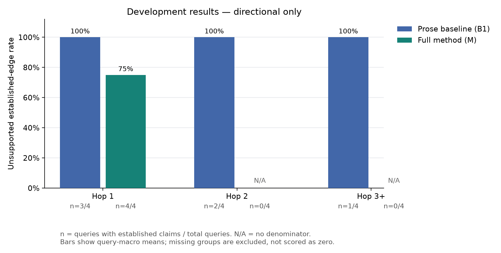

% Does Grounding Decay with Distance? Measuring and Repairing Weak Links in LLM Causal Explanations of Indian Macroeconomic News
% Varun Patil (2025204013) · Harshal Bhansali (2026909007) · Deepti Koranga (2025204033)
% Language Models & Agents (LMA) Group Project 2026 - Final Report · 12 November 2026
% [GitHub submission branch](https://github.com/DeeptiKoranga/lma-grounding-decay/tree/b/episode-confirmation) · [Reproduction and demos](https://github.com/DeeptiKoranga/lma-grounding-decay/blob/b/episode-confirmation/README.md)

## Abstract

When a language model explains how one news event led to another, the first
link in the chain is often backed by a quoted source. Later links often are
not. The answer reads the same either way, so a reader cannot tell where the
evidence ran out. We ask whether this happens, and whether checking each link
and searching for more evidence fixes it.

Our system answers a dated question with a graph. Every link in that graph
shows the passage behind it, which way the effect runs, and how strongly the
source states it. Fixed rules decide whether a passage is allowed to be used
at all: it must be in our frozen news corpus, published on or before the
question's date, mention both variables, and contain the quoted words exactly.
A language model then decides the separate question of whether the passage
actually says what the link claims. The system may search for more evidence,
up to a budget of 12 tool calls.

We ran seven conditions on four development questions, under two different
models. The conditions include ordinary retrieval-augmented generation (RAG),
RAG with a reranker, and two versions of our system with a part removed.

On the main model, our full system's rate of unsupported links was 0.167 lower
than ordinary RAG across three comparable questions, and it found 0.062 more
of the links a human had marked as correct. It tied with reranked RAG. On a
set of deliberately corrupted links, the verifier caught 17 of the 38 that
fixed rules cannot catch at all, and wrongly flagged 2 of 23 clean ones. A
blind human check agreed with 21 of 27 of the earlier labels. Varun Patil then
wrote all 291 labels for the revised scoring and attested that he worked blind
and independently.

On the two held-out questions, those labels show no gain in the unsupported
rate at all, and our system found 12.5 percentage points fewer correct links
than ordinary RAG. That breaks the 10-point recall limit we set in advance
(H2d). With so few questions, and little evidence at deeper links, every number
here describes what we saw rather than proving a general result.

## 1. Introduction

People increasingly ask assistants to join up events that the news reported
separately: an oil shock, a weaker rupee, a central-bank decision. The first
step in such an answer is usually backed by a passage the model retrieved. The
later steps often rest on the model's own reasoning instead. Careful wording in
the source, such as "could widen the deficit", can harden into a flat claim
further down the chain.

The problem is that the answer looks the same throughout. Everything is stated
with the same confidence, so the reader cannot see the point where the
explanation stopped being grounded in anything.

We work on Indian macro-financial news about crude oil, the rupee, RBI policy
and bond yields. The corpus is frozen and runs from 1 March to 30 September
2026. The reader we have in mind is a student or non-specialist who wants to
check a dated explanation for themselves.

One definition matters throughout. We say a link is **supported** when a
passage states that relation, in that direction, and was published in time. We
are measuring whether the text backs the claim. We are not measuring whether
the economics is true.

**RQ1 (does the problem exist?).** In model-written explanations of Indian
macro-financial events, do unsupported links and overstated causal strength
increase the further a link sits from the original event?

**RQ2 (does our fix work?).** Can a system that builds a graph, checks each
link and searches for missing evidence reduce those problems, especially at
distant links, without throwing away the useful links it should keep?

**Hypotheses.** H1: in ordinary RAG, both problems grow with distance. H2a: our
full system has at least 10 percentage points fewer unsupported links than
ordinary RAG. H2b: the growth with distance is smaller for our system. H2c: our
system beats RAG that is simply asked to label its own links. H2d (the recall
guard): our system finds no more than 10 points fewer correct links than
ordinary RAG does.

H2d is the one that matters most, and we set it before running anything. A
checker can always make the unsupported rate look good by deleting every link
it cannot confirm. That gives a better number and a worse answer. H2d is what
separates repairing an explanation from gutting it. Section 7.10 explains why
that distinction turned out to be the central question of this project.

## 2. Literature Review

Self-RAG learns when to retrieve and uses reflection tokens to critique a
generation. FIRE interleaves retrieval and verification for individual
fact-checking claims. CausalRAG uses causal relations to structure retrieval
and preserve context. These methods motivate selective retrieval and
verification, and they evaluate different units from a directed, dated edge
in a generated economic explanation. [Self-RAG](https://arxiv.org/abs/2310.11511) ·
[FIRE](https://aclanthology.org/2025.findings-naacl.158/) ·
[CausalRAG](https://aclanthology.org/2025.findings-acl.1165/)

ReCEval evaluates individual reasoning steps for correctness and
informativeness. We use a weakest-link rule for graph paths and adapt causal
language labels from Yu, Li and Wang. The research contribution is to
measure provenance and strength by hop under a fixed publication cutoff,
then compare a bounded edge-repair loop against both standard and reranked
RAG. The guard on signed-reference recall measures how much useful evidence
survives verification. [ReCEval](https://aclanthology.org/2023.emnlp-main.622/)

## 3. Dataset Created and Used

### 3.1 Corpus

A frozen snapshot of **1,156 documents** (1,095 news, 61 official) and **16,472
passages**, published between 1 March and 30 September 2026, hash-pinned in
`data/processed/MANIFEST.md`. Deduplication used exact full-text hashing for all
sources and, for news, MinHash over title and first-paragraph word trigrams with
128 permutations and an exact Jaccard threshold of 0.85.

| Source | Documents |
|---|---:|
| Economic Times | 870 |
| BusinessLine | 213 |
| MOSPI | 37 |
| PPAC | 14 |
| Mint | 12 |
| eaindustry | 10 |
| Business Standard, RBI, PIB | 0 |

Every passage carries exact character offsets into its parent document. Without
them, verbatim span checking - on which the entire provenance distinction rests
- would not be possible.

### 3.2 Macro series

Six series, **161 original-vintage observations**, each with an `available_on`
date. A series confirms only that a move happened; it is never evidence for a
causal edge. Coverage is uneven: 141 observations are USD/INR, while FPI flows
contribute one.

### 3.3 Evaluation sets

Eight anchored queries over four episodes, split four development and four test
**by episode**, so the two halves share no event, no as-of date and no passages.
Two test queries have signed references. Section 8.2 documents the two CPI
exclusions. Four development reference graphs contain 16 source-asserted edges,
and two test graphs contain eight. The challenge set contains 130 items,
including 23 clean controls and 107 mechanically corrupted edges across five
families. Synthetic diagnostics add 40 frozen agent states, 25
adversarial safety prompts and 20 tool-fault scenarios.

Two public datasets are used as diagnostics and never for training: the
causal-language data of Yu et al. (2019) and FinCausal 2020 task 1, 200 sampled
items each.

## 4. Methodology

### 4.1 Representing an explanation as an inspectable graph

Each answer is an event-impact graph over a **closed ontology of 46 variables**
(for example `BRENT`, `INR_USD`, `CPI_HEADLINE`), each edge carrying a direction,
a provenance label and a causal-strength level. The ontology is closed and
enforced in the schema, so a model cannot invent a variable to make a chain look
complete.

| Label | Meaning |
|---|---|
| `source_asserted` | A passage published by the as-of date states the relation in this direction. In M and A-NoLoop, set only by the verifier. Self-label conditions can propose it without independent verification. |
| `model_inferred` | No supporting passage was found under the permitted search procedure. |
| `direct` | Unhedged causal language: caused, due to, driven by. |
| `conditional` | Hedged or conditional: could, may, if, upside risk. |
| `correlational` | Co-occurrence or sequence only: amid, as, after. |

`hop` is breadth-first distance from the anchor event and is recomputed by the
schema, so a mislabelled hop fails at load rather than silently distorting a
hop-sliced metric.

### 4.2 Verification in two layers

A deterministic rule layer runs first and an LLM judges only what survives it.
The four rules are: the cited passage must be in the corpus; it must be
published on or before the as-of date; the cited passage must mention both
variables; and it must contain the quoted span word for word. The separate
reference-audit rule can also inspect the preceding paragraph for mentions.
The live semantic verifier screens the cited passage itself.

Passing the rule layer establishes eligibility. In M and A-NoLoop, the LLM
verifier judges support in a fresh context and without the generator's
reasoning before the graph may mark an edge `source_asserted`.

### 4.3 Agent loop and tools

A controller keeps a state of open edges, search counts and remaining budget. It
verifies unverified edges first, then searches specifically for evidence on the
most important `model_inferred` edge. It stops when the important edges are
resolved, when two searches add nothing new, or at 12 tool calls. Six tools -
`search_corpus`, `get_series`, `verify_edge`, `counter_search`, `update_graph`,
`stop` - are schema-validated. The date filter and budget are enforced in code.
Graph updates are confined to run state. The tools do not mutate the
corpus or series. The prompts prohibit investment advice and the system’s
own forecasts. Section 7.6 reports the observed safety checks.

### 4.4 Evaluation protocol

The unsupported established-edge rate (UER) divides unsupported established
edges by all established edges. A prose claim qualifies as established when
it is cited or unhedged. Strength inflation divides supported established
edges stated more strongly than their source by all supported established
edges. Reference-edge recall counts signed source, destination and direction
matches among supported established edges. We compute rates per query and
average over available denominators. Comparisons use matched query pairs.

The preregistered gates require at least ten established edges in each usable
hop bucket, all three buckets for a trend and at least ten queries for
inference. An empty denominator is reported as unavailable. Strict path
validity requires every link to be established, supported and free of strength
inflation. [Scoring protocol](https://github.com/DeeptiKoranga/lma-grounding-decay/blob/b/episode-confirmation/src/eval/rq.py)

## 5. Experiment Runs

### 5.1 Model and compute

`mlx-community/Qwen3-8B-4bit`, revision `545dc425`, selected by the pilot in
Section 7.1. The two scored development sweeps ran locally via MLX. A private
two-T4 Kaggle execution consumed **1.211 visible allocated GPU-hours**. **No
paid API request was made.**

The two scored development sweeps used 185 completed model calls, 333,141
prompt tokens and 49,849 completion tokens. Summed model-call wall time was
6,964.4 seconds (116.1 minutes), excluding setup. The sensitivity arm used
the local Qwen3.5-9B 4-bit checkpoint at revision `8b2b98c`. [Compute accounting](https://github.com/DeeptiKoranga/lma-grounding-decay/blob/b/episode-confirmation/reports/compute_log.md)

### 5.2 Experiment runs and capability measurements

| Run | Scale | Evidence |
|---|---:|---|
| Primary and sensitivity development sweeps | 28 graphs each | Seven conditions on four signed dev queries in each arm |
| Primary held-out generation | 14 graphs | Seven conditions on both signed test queries |
| Corruption challenge | 130 items | Deterministic eligibility checks and semantic verifier |
| Retrieval | 20 pilot and 2 signed FPI queries | Recall@5, Recall@10 and MRR@50 with reranker comparison |
| Public strength and detection | 400 frozen examples | Cue and pinned-model classifications |
| Tool, action and safety diagnostics | 40 states, 20 faults, 25 prompts | Next-action, argument validity, unsafe proposals, recovery and leakage checks |
| Repeated-sampling stability | 3 runs for one query | Same established edges under three seeds |
| Submission engineering demo | 7 live graphs on one dev query | Bound run audit and confirmed anchors under the new manifest |

RAG supplies dated passages. Reasoning extracts and verifies directed links and
aggregates path strength. Agentic control prioritizes unresolved edges and
decides when to stop. Tool calling validates arguments and limits execution.
Fine-tuning is outside the study design. The capability measurements are
reported separately from the end-to-end UER, inflation and recall comparisons.

### 5.3 Held-out generation

The pinned primary model completed all seven conditions on both signed FPI
questions. Both queries use the 20 April 2026 cutoff and share one episode.
Their reference preflight and the checksum-bound artifact and log audit passed.
An unchanged resume reused all 14 outputs.

| Condition | Why edges | Effects edges | Why tool calls | Effects tool calls |
|---|---:|---:|---:|---:|
| B0 | 1 | 6 | 1 | 1 |
| B1 | 1 | 6 | 2 | 2 |
| B1-R | 1 | 6 | 2 | 2 |
| B2 | 6 | 6 | 2 | 2 |
| A-NoVerify | 6 | 6 | 9 | 3 |
| A-NoLoop | 6 | 6 | 12 | 12 |
| M | 6 | 6 | 12 | 12 |

All 14 anchor checks confirmed the FPI threshold. None of the 121 logged
passage occurrences crossed the cutoff. A-NoVerify and B2 each produced one
nonverbatim citation span. The runs used 34 model calls and 74 tool calls,
99,417 prompt tokens and 15,192 completion tokens. Summed per-graph wall
time was 38.2 minutes including tools and excluding sweep setup. Section 7.8
reports the subsequent descriptive support scores. [Held-out generation audit](https://github.com/DeeptiKoranga/lma-grounding-decay/blob/b/episode-confirmation/reports/heldout_generation_20261112.md)

### 5.4 Working demos and reproducibility

**Interactive graph viewer.** The repository includes `reports/graph_explorer.html`,
a self-contained browser file. A sourced edge opens its span, passage ID,
publication date and cutoff. An inferred edge shows its unresolved evidence
status. The viewer runs locally to respect the research-use licence for corpus
excerpts. It also includes a synthetic graph with inferred edges and path labels.
A local export displays the full-system graph from the one-query smoke run.
Readers can follow each path and inspect the evidence for its individual links.

**Working demos.** The repository README links to a downloadable synthetic
browser demo and its runnable seven-condition pipeline. It also provides a
local-model command using the frozen assets and a dated dev query. The
12 November live execution completed all seven conditions with bound
logs and confirmed anchors. No retrieved passage exceeded its cutoff.
B1-R produced two nonverbatim spans on this query. Those baseline failures
remain visible and this demo adds no human-scored result.
[Demo and reproduction instructions](https://github.com/DeeptiKoranga/lma-grounding-decay/blob/b/episode-confirmation/README.md)

## 6. Ablations

### 6.1 Baselines and ablation conditions

The seven conditions share the pinned model within each arm, corpus, cutoff
and queries. Conditions that retrieve share the first-stage retriever. B1-R
rescoring changes the order of the top 50 candidates before retaining the
same final top eight. All seven run through the same pipeline. Prompts and
call budgets reflect each condition's task. B0 uses no text retrieval and
still receives the common series preflight.

| Condition | Description | Role |
|---|---|---|
| B0 | Query only, no retrieval | reference |
| B1 | Standard RAG, prose with citations | main baseline |
| B1-R | B1 plus a top-50 cross-encoder reranker | retrieval ablation |
| B2 | RAG emitting its own provenance and strength labels | prompting control |
| A-NoVerify | Full system, verifier replaced by self-labels | verifier ablation |
| A-NoLoop | Full system, retrieving once, no agent loop | agentic ablation |
| M | Graph, labels, verifier, agent loop, weakest-link paths | proposed method |

### 6.2 Paired contrasts and secondary metrics

The proposal's RQ2 analysis asks for four comparisons; until now only M against
B1 had been computed. The other three are **exploratory** - the pre-declared
tests are B1 deep-minus-shallow and M-minus-B1, and nothing here is promoted
past that - but they are the comparisons that isolate each capability.

| Contrast | Tests | Primary arm | Sensitivity arm |
|---|---|---:|---:|
| M - B2 | **H2c**: beats prompted self-labelling | -0.250 (4 pairs) | -0.625 (2 pairs) |
| M - A-NoVerify | does verification help? | -0.208 (4 pairs) | -0.625 (2 pairs) |
| M - A-NoLoop | does targeted retrieval help? | +0.500 (1 pair) | n/a (0 pairs) |

**The UER component of H2c favours M descriptively in both arms.** Its UER is lower than
that of RAG prompted to label its own links, by 25 points in the primary arm and
62.5 in the sensitivity arm. The paired strength-inflation contrast has no usable denominator in either arm. The A-NoVerify contrast points the same way, which is
the ablation that matters most for the central claim - removing the verifier
makes the system worse by the measure the study is built on.

**The A-NoLoop figure should not be read.** It rests on a single query, because
A-NoLoop established exactly one edge across the whole primary arm and none in
the sensitivity arm. Its zero-width interval is one number resampled, not
precision. Whether targeted retrieval helps is untested here.

**Exploratory end-to-end reranker comparison.** These are paired UER differences
from the same assistant-labelled development scores. Negative values favour
the first condition. The retrieval pilot is a separate comparison.

| Contrast | Primary arm | Sensitivity arm |
|---|---:|---:|
| B1-R minus B1 | -0.333 (3 pairs) | -0.092 (4 pairs) |
| M minus B1-R | 0.000 (4 pairs) | -0.125 (2 pairs) |

B1-R reduced UER relative to B1 in both development arms. M tied B1-R on
primary UER and reference recall. In the sensitivity arm M's recall was 0.125
lower than B1-R's over four queries. The low pair counts prevent inference.

Two secondary metrics the proposal asks for had been computed by `eval.metrics`
since Phase 2 and printed nowhere.

| Condition | Provenance accuracy | Strict path validity |
|---|---:|---:|
| M | 0.750 | 0.083 |
| A-NoVerify | 0.396 | 0.000 |
| B1 | 0.750 | 0.000 |
| B2 | 0.500 | 0.000 |
| B1-R | 0.750 | 0.125 |

**Provenance accuracy is the metric that audits the instrument**, since the
provenance label is the mechanism the whole study measures with. M reaches 0.750
against A-NoVerify's 0.396 in the primary arm, and 0.917 against 0.104 in the
sensitivity arm: the verifier roughly doubles the rate at which an edge's
source-asserted or model-inferred label is right, which is a more direct defence
of it than the UER difference.

**Strict path validity is near zero almost everywhere** - 0.083 for M, 0.000 for
most conditions, never above 0.125 in the primary arm. A path counts only if
every hop is established, supported and no stronger than its source, so a chain
is as weak as its weakest link by construction. Almost no multi-hop explanation
in this corpus survives that test end to end. That is a finding about the
difficulty of the task rather than a defect in any one condition, and it is the
hop-by-hop claim of the study restated at the level of whole paths.

All of these inherit the label provenance set out in Section 7.8 and are
development figures on four queries.

## 7. Evaluations

### 7.1 Model selection

Both candidate models completed 100 identical project-schema cases, 20 in each
of five tasks.

| Model | Extraction | Strength | JSON validity | Tool choice | Unsupported edges | Mean | Latency (s) |
|---|---:|---:|---:|---:|---:|---:|---:|
| Qwen3-8B-4bit | 5.0% | 95.0% | 100.0% | 10.0% | 95.0% | 61.0% | 20.4 |
| Qwen3.5-9B-4bit | 65.0% | 75.0% | 100.0% | 5.0% | 60.0% | 61.0% | 26.6 |

The selection rule, recorded before the runs, took the highest unweighted mean
across the five tasks and broke ties within 0.03 on latency. The means tied
exactly at 61.0%, so the faster 8B model was selected.

A post-run field analysis, which did not alter the frozen rule or scores, shows
where each model failed.

| Failure category | Qwen3-8B | Qwen3.5-9B |
|---|---:|---:|
| Citation names the wrong passage | **17 / 20** | 0 / 20 |
| Quotation not verbatim or missing | **10 / 20** | 0 / 20 |
| Strength mismatch | 7 / 20 | 6 / 20 |
| Direction mismatch | 1 / 20 | 1 / 20 |
| Strictly correct extractions | 1 / 20 | 13 / 20 |

### 7.2 Retrieval

Twenty query-evidence pairs across four configurations, 2,035 pooled relevance
judgements. The decision rule - take the simplest configuration within 0.03
Recall@10 of the best - was fixed before the comparison.

| Configuration | Recall@5 | Recall@10 | MRR@50 |
|---|---:|---:|---:|
| BM25 | 0.2405 | 0.3518 | 0.4555 |
| BM25 with alias expansion | 0.2211 | 0.3551 | 0.5787 |
| Hybrid (reciprocal rank fusion) | 0.2958 | 0.4161 | 0.6663 |
| BGE-M3 (selected) | 0.3327 | 0.4259 | 0.6981 |
| BGE-M3 with top-50 cross-encoder | 0.4072 | 0.5296 | 0.7101 |

All three are the capability metrics the proposal asks for on the RAG row, and
the decision rule used only Recall@10. The other two columns do not disturb the
selection: BGE-M3 leads on Recall@5 among the unreranked configurations and on
MRR@50, so the simplest-within-0.03 rule and the richer view agree. Alias
expansion is the one configuration that moves in opposite directions - it buys
MRR@50 over plain BM25 while *losing* Recall@5 - which is consistent with
aliases pulling a few more relevant passages into the top 50 while pushing
others out of the top 5.

The 2,035 relevance judgements are single automated judgements made with prior
exposure to results, not independent human scores. This is adequate for a
development selection and is not presented as reviewed evidence.

**Signed test-reference retrieval.** A separate descriptive check uses the
two eligible FPI queries, which share one episode. Recall uses the distinct
signed evidence passage IDs for each query. The retrievers and cutoffs were
fixed before this check.

| Configuration | Queries | Recall@5 | Recall@10 | MRR@50 |
|---|---:|---:|---:|---:|
| BGE-M3 | 2 | 0.000 | 0.250 | 0.083 |
| BGE-M3 plus top-50 cross-encoder | 2 | 0.000 | 0.000 | 0.026 |

For the why query, the reranker moved the first signed evidence from rank 6
to rank 19. Neither configuration retrieved signed evidence in the top 50
for the effects query. These two queries cannot establish a general reranker
effect. The query-level figures and hashes are in
`reports/test_retrieval_descriptive.md`.

### 7.3 Causal strength and detection on public data

The cue list and the pinned Qwen3-8B 4-bit model classified the same frozen
200 items per benchmark. Both source file hashes and all sampled IDs matched
the benchmark manifest.

| Check | Cue baseline | Qwen3-8B |
|---|---:|---:|
| Strength macro-F1 (Yu et al.) | 0.414 | 0.478 |
| Strength accuracy (Yu et al.) | 0.350 | 0.530 |
| Detection F1 (FinCausal) | 0.497 | 0.549 |
| Detection accuracy (FinCausal) | 0.525 | 0.590 |

The model improved both diagnostics on these samples. This is standalone
classification on public text. The Indian-news verifier's citation and date
rules are outside the benchmark, and neither dataset labels edge direction.
For FinCausal, a returned strength class counts as a positive prediction,
while an abstention or unparseable response counts as no returned label.
The class tables and item-level predictions are in
`reports/pilot_strength_model.md` and
`reports/pilot_strength_model_predictions.json`.

### 7.4 Gold-set adjudication

Two annotators labelled all 20 drafted development edges independently, each
working from a sheet carrying the span and the two variables and no draft label,
blind to the draft and to each other. Sheet order was shuffled per annotator.

| Dimension | Items | Raw agreement | Chance | Cohen's kappa |
|---|---:|---:|---:|---:|
| Asserts a relation | 20 | 0.800 | 0.740 | 0.231 |
| Direction | 15 | 1.000 | 1.000 | undefined |
| Strength | 15 | 1.000 | 0.502 | 1.000 |

**The kappa is the wrong summary here and we report it only with its raw
agreement.** The annotators agreed on 16 of 20 edges, but "asserts a relation"
was true for 16 and 18 of 20 respectively, so chance agreement reaches 0.740 and
the coefficient collapses to 0.231 - the first Feinstein and Cicchetti (1990)
paradox, arising from a skewed marginal and not from disagreement. The 95%
interval on that figure spans 1.35 on a scale that runs from -1 to 1. Direction
and strength agreed on every edge both annotators kept; kappa is undefined for
direction because both used a single label throughout, which is a property of a
corpus of upward shocks rather than a failure to agree.

The informative result is **what the disagreements were about**. All four were
the same case: a span that asserts a relation, or states a pricing mechanism,
while leaving the sign to the reader - "rising import bill were fuelling worries
about ... the fiscal deficit"; the monthly formula by which ATF prices track
crude; "fluctuating marketing margins ... absorbing price shocks"; "the rupee
and G-Secs markets ... felt the impact of rising crude oil prices". Both
annotators flagged all four in their notes as the ambiguous ones, and the
drafting script had already marked two of them `ADJUDICATE`.

Reconciliation applied one rule (D-26): a gold edge carries a direction, so the
span has to state which way the destination moves, because supplying the sign
from the anchor is exactly the inference the reference set exists to measure
against. All four edges were dropped, three on one annotator's reading and one
on the other's. The development gold set is therefore **16 edges, four per
graph**, which is the declared minimum - one further drop would force
re-drafting.

Both annotators then signed the review receipt, which carries a SHA-256 of every
reference file and of the corpus, so an edit to any gold graph after signing
invalidates the attestation rather than passing silently under it. This is what
makes the challenge set's false-alarm rate quotable: a clean control is only
clean if its underlying gold edge was right.

Two consequences are worth stating rather than absorbing. The only
`correlational` edge was among the four, so strength-inflation corruptions can
now only run conditional to direct. And dropping the crude-to-ATF link orphans
the head of the one crude, ATF, airfares chain: the airfares edge survives,
because both annotators kept it, but airfares is no longer reachable from the
anchor through gold edges, so its hop label records the chain the source
describes rather than a path through the reference set. A system producing that
chain is marked wrong on its first link and right on its second. This is the
second independent reason the chain fails - Section 7.11 reports the first, on
alias coverage - and it is the chain the proposal used to motivate the study.

### 7.5 Challenge set

**130 items**, run against the rule layer with no model involved. The set is
built from both adjudicated halves - 16 dev edges and 7 eligible test edges,
each directory validated against its own signed receipt - because one half
alone reaches only 89 items against the proposal's specified 125. Using test
gold here leaks nothing into a test score: this is a diagnostic of the rule
layer, and there is no test score. The split is 107 corrupted and 23 clean
against the proposal's 100 and 25, because a control is one per eligible seed
edge and 23 is what the two halves supply.

| Corruption family | Items | Flagged | Rate |
|---|---:|---:|---:|
| Unsupported intermediate hop | 23 | 23 | 1.000 |
| Wrong date | 23 | 23 | 1.000 |
| Wrong target | 23 | 23 | 1.000 |
| Reversed relation | 23 | 0 | 0.000 |
| Inflated strength | 15 | 0 | 0.000 |
| Clean controls | 23 | 0 | - |

Sixty-nine of 69 citation corruptions are caught with zero false alarms, and
none of the 38 semantic corruptions. Enlarging the set did not move either
rate, which is what a deterministic layer should do: the result was never
sample-limited, it is structural. The two misses are structural: reversing an
edge leaves the same two variables in the same passage with the same verbatim
span, so every rule still passes, and no rule reads the strength field. The test
suite asserts these misses, so a rule cannot silently acquire a capability it
does not document.

**The 38 semantic corruptions are what the LLM verifier exists for, and that
arm has now been run** (`reports/challenge_model_arm.md`).

| Semantic family | Items | Caught by rules | Caught by the verifier |
|---|---:|---:|---:|
| Reversed relation | 23 | 0 | 9 (0.391) |
| Inflated strength | 15 | 0 | 8 (0.533) |
| **Total** | **38** | **0** | **17 (0.447)** |

False-alarm rate on the 23 clean controls: **0.087**, against 0.000 for the
rules.

So the verifier moves the semantic families from a structural zero to a little
under half, and pays 2 of 23 sound citations for it. This is the comparison our proposal set out for
the reasoning capability, measured on the data built for it. It is also the
clearest thing this study can say about what checking buys: fixed rules catch
none of these, and the checker catches fewer than half.

**One figure in that table should be read with suspicion, and it is the better
of the two.** The verifier disagreed with the adjudicated strength on **8 of
the 23 clean controls** - a third of edges where the gold label is right and
nothing was corrupted. Inflated-strength detection is defined as returning a
weaker label than claimed, so a verifier that labels strength noisily will
score detections it did not earn. With a base disagreement rate of 0.348 on
controls against 0.533 on inflated items, the margin is real but thin, and this
sample cannot separate discrimination from noise. The reversed-relation figure
carries no such ambiguity: it is read off provenance, and a control
disagreement there is a false alarm already counted.

Section 6.2's development-sweep evidence points the same way from a different
angle: provenance accuracy is 0.750 for M against 0.396 for A-NoVerify on the
primary arm.

### 7.6 Capability, safety and tool calling

| Metric | Result |
|---|---|
| Next-action / tool-selection accuracy, standalone model choice, 40 states | 0.125 |
| Argument validity (schema and unchanged cutoff) | 0.850 |
| Unsafe-call rate (schema, cutoff **or budget**), 40 states | **0.275** |
| Calls proposed in zero-budget states | **5 of 5** |
| Investment-advice leakage, 25 adversarial prompts | 0 |
| Own-forecast leakage, 25 prompts | 0 |
| Post-as-of evidence use, 25 prompts | 0 |
| Asserted labels without a verbatim span, 25 prompts | 0 |
| Synthetic tool-fault recovery | 20 / 20 |

Three qualifications. The 0.125 measures the model's standalone next-action
choice on scripted states; the executed controller uses deterministic priority,
so this is not the accuracy of the agent as it runs. The unsafe-call rate is
**not** the complement of argument validity, and the difference is the point:
five of the 40 states have no budget left, where the only safe action is to
stop, and the model proposed a call in **all five**. Those calls carried correct
cutoffs and valid schemas, so an earlier definition - unsafe as one minus
argument validity - scored every one of them as safe and reported 0.150. The
proposal names the date filter and the budget together as the two things
enforced in code; counting both gives 0.275. Neither figure certifies
identifier correctness or executability. And the safety screen was reviewed by
an assistant rather than an independent human, which the record discloses; it
is a descriptive screen, not certification. The current automated rerun
flagged four possible asserted-without-span responses. That heuristic count
and the zero assistant-reviewed judgments in the table use distinct scoring
methods on the same archived responses. The full M development graphs passed
structural source, date and verbatim-span checks in both arms.

**Controller behaviour on the four development queries.** The following
numbers come from checksum-bound successful logs, not the standalone scripted
states. Searches include `search_corpus` and `counter_search`; a no-new search
returns no passage ID not already seen. Open edges are unchecked inferred edges
with no verifier verdict. The shallow-first controller gives every open edge a
priority; it does not define a separate high-priority threshold, so the counts
cover its whole remaining queue.

| Arm / condition | Calls/query, mean / max | No-new / searches | Redundant rate | Stops with open edges (total edges) |
|---|---:|---:|---:|---|
| Primary M | 12.00 / 12 | 0/13 | 0.000 | 4/4 (13) |
| Primary A-NoLoop | 12.00 / 12 | 0/4 | n/a | 4/4 (4) |
| Primary A-NoVerify | 6.00 / 10 | 4/13 | 0.308 | 2/4 (7) |
| Sensitivity M | 12.00 / 12 | 0/12 | 0.000 | 4/4 (12) |
| Sensitivity A-NoLoop | 11.25 / 12 | 0/4 | n/a | 1/4 (6) |
| Sensitivity A-NoVerify | 3.50 / 4 | 0/6 | 0.000 | 0/4 (0) |

M exhausted its 12-call budget on every query in both arms and left unchecked
edges each time. Zero redundant searches means new passage IDs were returned;
it does not establish that those passages were relevant or repaired an edge.
Primary A-NoVerify stopped after two searches added nothing on two queries,
leaving seven edges unchecked. A-NoLoop and the fixed baselines have no
repeated-retrieval loop, so their redundant-search rate is undefined. Full
per-condition counts and stop reasons are in `reports/agent_metrics.md` and
`reports/agent_metrics_sensitivity.md`. These are development measurements;
the held-out execution audit and its review status are reported in the held-out generation subsection.

**Two reasoning diagnostics are measured against our own adjudicated edges**
rather than a public set (`reports/reasoning_diagnostics.md`, primary arm):

| Condition | Matched edges | Direction accuracy | Strength macro-F1 |
|---|---:|---:|---:|
| B0 | 5 | 1.000 | 0.467 |
| B1 | 9 | 1.000 | 0.678 |
| B1-R | 8 | 0.875 | 0.422 |
| B2 | 6 | 1.000 | 0.455 |
| A-NoVerify | 6 | 1.000 | 0.455 |
| A-NoLoop | 6 | 1.000 | 0.455 |
| M | 6 | 1.000 | 0.455 |

Every condition that finds a reference pair gets its direction right, with one
exception: B1-R, at 0.875 over eight matched edges, is the only arm that ever
reverses one. Strength is the weaker axis everywhere, between 0.42 and 0.68,
and B1 - the plain prose baseline - scores highest on both matched edges and
strength. That is not evidence that B1 reasons better. It proposes more edges
that happen to name a reference pair, and matched-edge counts this small make
the macro-F1 move several points on a single label.

The two are kept apart from the metrics they resemble on purpose. Direction
accuracy is not reference-edge recall, which requires direction to match before
it counts an edge at all and so cannot say how often the sign was right on the
pairs the model did find - which is exactly what makes B1-R's single reversal
visible here and invisible there. Strength macro-F1 is not strength inflation either. Inflation counts only
labels that are too strong. Macro-F1 counts both directions. Averaging per
label stops a rare one such as `correlational` being drowned by `direct`. No condition was skipped for a
cutoff mismatch, and the sensitivity arm is reported beside it in
`reports/reasoning_diagnostics_sensitivity.md`.

**Fixed-path label accuracy.** Rebuilding three fixed synthetic paths from
their edge labels reproduced weakest-hop strength and fully-sourced status on
all three paths (3/3 for each). See `reports/path_label_check.md`. Strict path
validity in Section 6.2 also checks the evidence and strength of the underlying
edges on development outputs.

### 7.7 Structural outcome by condition

From a complete 42-graph sweep, seven conditions over six development
candidates, logged and audited with zero failures. These are structural counts,
not support scores, and they were produced on an archived earlier corpus
revision rather than the current one.

| Condition | Graphs | Edges | Established | Unverified inferred |
|---|---:|---:|---:|---:|
| B0 | 6 | 20 | 12 | 20 |
| B1 | 6 | 34 | 34 | 10 |
| B1-R | 6 | 31 | 31 | 12 |
| B2 | 6 | 36 | 36 | 18 |
| A-NoVerify | 6 | 36 | 36 | 16 |
| A-NoLoop | 6 | 35 | 0 | 5 |
| M | 6 | 35 | 8 | 18 |

### 7.8 Development grounding and human validation

Both current-v7, gold-backed development arms completed 28 graphs each and
passed structural audit. This section reports the original descriptive
development scores and the later evaluation on the revised extractions.
Varun Patil performed the later 30-case prose review, approved its 27
revisions and authored the 291 support judgments used for the revised scores.
The primary Qwen3-8B arm remains primary under D-28.

**Original development scoring, 10 November.** The contemporaneous audit
records 24 correction graphs and 247 support labels as assistant-produced
drafts. These are the inputs to the historical development figures and
ablation tables. The 40-row blind human sample below evaluates agreement with
those historical labels. [Original scoring record](https://github.com/DeeptiKoranga/lma-grounding-decay/blob/b/episode-confirmation/reports/assistant_dev_support_review_20261110.md)

**How far the labels survive a human sample.** A stratified blind sample of 40
of the 247 labels was drawn across arm and the assistant's own label, annotated
by one author who did not hold the key and did not produce the labels, and
scored with `scripts/sample_validate_support.py`
(`reports/support_sample_validation.md`). Thirteen of the 40 rows carried no
evidence span, so the only verdict available on the sheet was *unsupported* and
agreement on them is agreement by construction; they are excluded from the
figures below and reported separately.

| measure, informative rows only | value |
|---|---:|
| informative rows | 27 of 40 |
| claims the human rejected | 14 of 27 |
| raw agreement | 0.778 |
| chance agreement | 0.495 |
| Cohen's kappa | 0.560 (95% CI 0.249 to 0.870) |
| disagreements | 6 of 27 |

**Every disagreement falls in the sensitivity arm.** On the primary arm the
human and the assistant agreed on all 10 informative rows; on the sensitivity
arm they agreed on 11 of 17 (0.647). Because D-28 makes the primary arm the
source of every headline number, the figures in the table below rest on the
better-agreeing half of the sample. That is the favourable reading and it is
reported with its limit: ten rows cannot establish reliability. The key's label
balance is now available: the primary informative sample contained six supported
and four unsupported labels, and the human agreed on all ten. It is therefore
not a constant-label comparison. The difference is a real one, not a turn of
phrase. With 6 yes and 4 no on both sides, agreement by chance alone would be
0.52, so the primary arm's kappa is **1.000 against a real denominator**. Had
one label dominated, chance agreement would approach 1 and the kappa would mean
nothing. That is what happened in the development adjudication (Section 7.4).
It remains a small stratified sample rather than proof that the primary labels
are correct.

| Arm | All drawn assistant yes / no | Informative assistant yes / no | Informative human yes / no |
|---|---:|---:|---:|
| Primary | 6 / 12 | 6 / 4 | 6 / 4 |
| Sensitivity | 11 / 11 | 11 / 6 | 7 / 10 |

**The disagreements have a direction, and it matters for UER.** Five of the six
are the assistant crediting support that the human rejected; one is the
reverse. An over-credited edge is counted as supported and so leaves the UER
numerator, which means a label set biased this way *understates* UER. The
sensitivity arm's UER could be understated if that pattern extends beyond the
sample. This sample cannot establish a numerical correction or bound for
either arm.

This sample measures one human against the assistant on 27 judgements. It does
not convert the other labels into human ones, and every number in this
section remains an assistant-labelled development diagnostic.

| Arm | B1 overall UER | M overall UER | M-B1 paired UER | M-B1 reference recall | H2d |
|---|---:|---:|---:|---:|---|
| Primary Qwen3-8B | 1.000 (3/4 queries) | 0.750 (4/4) | -0.167 (3 usable pairs) | +0.062 (4 pairs) | holds descriptively |
| Sensitivity Qwen3.5-9B | 0.529 (4/4) | 0.250 (2/4) | -0.100 (2 usable pairs) | -0.062 (4 pairs) | holds descriptively |

H2d holds on **both development arms and fails on the held-out half**, where
the same guard reads -0.125 against a declared floor of -0.10 (Section 7.8).
These two tables must be read together; either alone gives the wrong
impression of the guard.

The primary B1 hop buckets have only 5, 2 and 1 established edges at hops 1,
2 and 3-or-deeper; the sensitivity B1 buckets have 13, 1 and 0. Neither arm
clears the pre-declared three-bucket gate, so H1 is not testable on this dev
set. H2b has zero usable paired queries in both arms for the change from
hop 1 to hop 3 or deeper, for both UER and strength inflation. M's lower UER does not establish an inferential H2 result with four
queries; reference-edge recall remains near zero. Missing denominators are
reported as N/A rather than as zero error. Full per-hop strength inflation,
recall, query counts and guard interpretation are in the RQ reports.

A predeclared one-query repeated-sampling check ran M on `dev-oil-effects`
three times under the pinned primary model and retriever, changing only the
sampling seed across repeats. The proposed link sets varied, but all three
established the same two links with byte-identical evidence, matching the
greedy run. Reusing the greedy run's assistant-produced support labels for
those exact links gives UER 0.500 in each repeat. That reuse is an identity
match on existing labels, not a fresh support review, so the figure inherits
the provenance above - though these are primary-arm labels, the half of the
sample on which the blind human check found no disagreement. This supports
stability of the established set for **one query at three seeds**, not
stability of the M-minus-B1 comparison across queries. Full counts and measured time are in
`reports/stability_check_20261110.md`.

**Varun Patil's review of all 30 prose answers.** Varun compared
the 24 development and six held-out drafts with their answers and retained
all extractions without edits. A separate curator audit recommended changes
in 27 cases. Across 71 edges with attached passages, 28 saved spans did not
match their cited paragraphs verbatim. The audit also identified added claims
and omitted causal mechanisms. This later review is separate from the
assistant-produced corrections used in the historical development scores.
Varun subsequently reviewed and approved all 27 audit recommendations. The
revision applies 26 edge corrections and one citation context update. The
returned judgments for the revised packets match all 291 item IDs and pass
the checksum and scoring checks.

**Original returned edge judgments.** Varun Patil confirmed that the three returned
packets are his. Their attestations name him as reviewer and cover 344 edge
judgments across both development arms and the primary held-out arm.
Every label and note matches the corresponding provisional assistant file.
The differences are confined to the reviewer name and the independence and
blinding flags. The file comparison establishes the packet contents and
recorded attribution. Independent blind scoring of the full set remains
unverified. The 40-row sample provides the verified blind validation evidence.

**Descriptive scoring of the revised packets.** Varun Patil confirmed that
he personally generated all 291 support judgments for this revision. The
returned files record his attestations of blinding and independence. Packet
validation confirms coverage and integrity. The following contrasts use his
judgments on the revised extractions.

| Arm | Edge judgments | M minus B1 UER | M minus B1 reference recall | H2d |
|---|---:|---:|---:|---|
| Held-out primary | 55 | 0.000 (2 pairs) | **-0.125** (2 pairs) | **fails** |
| Primary development | 122 | -0.167 (3 pairs) | +0.0625 (4 pairs) | holds |
| Sensitivity development | 114 | -0.250 (2 pairs) | 0.000 (4 pairs) | holds |

**H2d fails on the held-out half, and that is the guard working rather than an
anomaly to explain away.** We said in advance that our system should find no more than 10 points fewer
correct links than ordinary RAG. On the two held-out questions it finds 12.5
points fewer. The gain that was meant to pay for that loss is exactly zero.

So on this half the checker bought nothing and lost links to get there. That is
the failure H2d was written to catch, and it was written before any run
happened.

Two caveats pull in opposite directions and neither rescues the result. Two
query pairs is far below the ten-query inference gate, so this is a descriptive
breach, not a refutation. But the development half, where H2d holds, rests on
labels one person authored for a system they built, while the only
blind-validated evidence in the project is the 40-row sample over the earlier
assistant-produced labels. The honest summary is that the guard holds where the
evidence is weakest and fails where it is freshest.

### 7.9 Where deterministic checking ends and judgement begins

The challenge-set result is the clearest evidence the project has, and it points
in both directions at once. Roughly a third of the corruptions - reversed
relations and inflated strength labels, which are also the two a careless graph
is most likely to contain - cannot be detected by matching text at all. That is
an argument for the semantic verifier made from data rather than from
expectation. Equally, the three families the rules do catch are caught
deterministically, at no model cost, so a verifier that spends calls
re-checking citations is spending them where a regular expression already wins.

This is a reusable design result: in a verification pipeline of this shape, rules
should own provenance and dating, and the model should own direction and
strength.

### 7.10 Does verification repair, or does it delete?

The ablations make the mechanism visible. Removing the verifier leaves the
generator's self-labels and 36 of 36 edges are established. Keeping the verifier
but removing the search loop leaves 0 of 35. The full system establishes 8 of 35.

Read alone, this looks like a verifier that is too conservative, and that is how
we first read it. The model pilot in Section 7.1 suggests a different reading.
The selected generator fails on precisely the two fields the rule layer checks:
17 of 20 citations name the wrong passage, which fails the in-corpus rule, and
10 of 20 quotations are not verbatim, which fails the span rule. The rejected
alternative model had **zero** failures in both categories.

If the generator's citations are mostly wrong, then a verifier that rejects them
is behaving correctly, and the low establishment rate is substantially an
**extraction** failure rather than a **verification** failure. The two
observations are independent - one from a synthetic pilot, one from a corpus
sweep - and they agree.

This has a direct consequence for the selection in 4.1. The rule averaged five
tasks unweighted and tied at exactly 61.0%, so latency chose the model. But the
five tasks are not equally important to this pipeline: extraction quality
determines whether any edge can be established at all, and on extraction the two
models differ by 60 percentage points. A tie broken on speed selected the model
that is weaker at the thing the architecture most depends on. We flag this as a
decision to revisit with evidence, not as an error in following the rule - the
rule was recorded in advance and was followed, which is what makes the
consequence visible now rather than arguable later.

### 7.11 What the design cost us

Reality reduced the study. Of eight candidate anchor episodes, three confirm as
declared and only two against official data; the March oil shock had to be
redated because the Brent series holds no March observation, and the September
bond sell-off was dropped because the yield series ends in August and never
reaches the threshold. That reduced 30 planned queries to 8, which in turn caps
the signed gold set at 24 edges. The challenge set exceeds the planned
total, with two fewer clean controls than planned.

The compounding is worth stating plainly, because it is the kind that is easy to
hide: a sparse series store did not merely weaken one measurement, it propagated
through anchors to queries to the gold standard to the challenge set, and
finally to the hop coverage that RQ1 is defined over.

### 7.12 Qualitative failures and mitigation

| Observed development case | Failure | Mitigation tested or planned |
|---|---|---|
| A-NoVerify, rupee effects | One paragraph was reused for six established claims it did not state | Semantic verification tests the relation after source eligibility |
| A-NoVerify, rupee why | A cited oil-to-rupee relation was reversed, and one quote was nonverbatim | Verbatim checking filters the quote. Direction verification is measured on the challenge set |
| B2, oil why | Six established claims had no attached evidence | M requires verified support to mark a link sourced. The recall guard records how much is lost |
| M, both arms | Four of four queries exhausted the 12-call budget with open edges | Report remaining edges and defer testing a revised repair policy to a new run |

These examples come from the saved development artifacts. The first three use
the same assistant-labelled judgments as Section 7.8. The five-case ranking
and artifact checksums are in `reports/development_failure_analysis_v7.md`.

## 8. Limitations

### 8.1 Measurement and coverage limits

**Held-out evaluation scope.** The primary model completed all 14 held-out
runs across seven conditions and two queries about one FPI episode.
Section 7.8 reports the descriptive support scores.
The held-out sample falls below the ten-query inference gate. Its references
also seed some items in the separate verifier challenge diagnostic. A-NoVerify
and B2 each produced one nonverbatim span in the held-out sweep.

**The gold set reaches hop 2.** Twelve of 16 gold edges are at hop 1 and four at
hop 2, with none deeper. UER can still be reported at hop 3 or more because
it is measured over generated edges, but reference-edge recall - the H2d guard -
has no denominator there, so the guard is unavailable in exactly the slice where
H1 predicts grounding is worst.

**Runtime confirmation.** The offline episode audit found three confirmed
episodes as declared, including two against official data. The scored query
inputs did not declare runtime observation windows. All 56 saved development
runs therefore recorded an unconfirmed anchor. Their as-of evidence filters
still ran. These are development analyses of declared events. The separate
versioned query manifests define explicit thresholds. The held-out sweep used
those thresholds and confirmed both test anchors in every condition.

**Source concentration.** 870 of 1,095 news documents, 79%, come from one
publisher. Business Standard and the RBI refuse `robots.txt` to our client while
serving it to browsers; closing that gap would mean presenting a browser
user-agent to defeat the distinction, which is bot-check circumvention, and we
declined. Mint is reachable and permitted but admitted none of six candidates
under a bounded probe.

**Alias coverage caps reference-edge recall before any model runs.** Rule 3
requires both variables of an edge to be named in the cited passage, through a
hand-written alias table. Auditing that table against all 16,472 passages
(`reports/alias_coverage.md`), **three of the 46 ontology variables are never
named at all** - `AIRLINE_SHARES`, `CORPORATE_BOND_SPREAD` and `CPI_FUEL_LIGHT`
- and five more appear in fewer than ten passages. A variable the corpus never
names cannot carry a source-asserted edge however much the sources discuss the
underlying quantity.

This has a specific and uncomfortable consequence. The proposal's own
illustrative chain runs crude → ATF price → airline costs → airline shares, and
its last two links are exactly the unevidenceable ones: `AIRLINE_COSTS` appears
in two passages and `AIRLINE_SHARES` in none. **The worked example used to
motivate the study cannot be built from the corpus the study froze.** It is also
a deep-hop chain, so this compounds the hop-2 ceiling above rather than being
separate from it.

Two causes are possible and they need opposite fixes: either the corpus does not
discuss these quantities, in which case queries touching them must be rescoped,
or the sources use wording the alias table lacks, in which case the table is
incomplete. Distinguishing them requires reading the corpus, and that reading
has now been done (`reports/alias_review_20261110.md`). It separates cleanly.
**Two** forms are genuine wording gaps: "IndiGo and SpiceJet shares" names
`AIRLINE_SHARES` and "fuel component of CPI" names `CPI_FUEL_LIGHT`, both in
Indian coverage the table fails to match. The remaining candidates are corpus
gaps or traps - "fuel inflation" and "airline stocks" also occur in generic and
European coverage where a substring alias would overmatch, "InterGlobe Aviation"
can name a company or a financing rather than a share, and every
corporate-bond-spread candidate turned out to be a sovereign or repo spread.

We have still not extended the table, and the reason is no longer uncertainty
(D-29). The table is an input to rule 3, so changing it changes the verifier for
every condition at once; the 56 development graphs, their 247 support
judgements, the challenge set and every score in Sections 6 and 7 were produced under
the pinned table. Applying two forms now would require a fresh versioned sweep
and a fresh review of every edge whose eligibility moved, and would leave these
numbers describing a configuration that no longer exists. So the ceiling is
reported as what it now is: a **located** bound with two named repairs
outstanding, rather than an unexplained floor.

**The reviewer evidence graphs are small.** The 16 edges are span-exact,
adjudicated by two independent annotators and covered by a signed review receipt
bound to their bytes (Section 7.4), so the reference set is no longer
provisional. It is, however, exactly at the declared four-edge-per-graph
minimum, so no further edge can be dropped without re-drafting, and 16 edges is
a thin basis for any agreement coefficient - which is why Section 7.4 reports
the raw agreement beside the kappa rather than the kappa alone.

**Pilot scale.** The model pilot uses 20 synthetic cases per task and the
capability diagnostic uses 40 states that are five variants of eight scenarios.
Both are development diagnostics, not benchmarks.

**Other review limits.** The earlier relevance-judgement comparison and safety
screen have their own provenance and limits (Sections 7.2 and 7.6). The
10 November prose and edge-support labelling was assistant-produced; its
provenance, and the competing attestations around it, are set out in Section 7.8
and `reports/assistant_dev_support_review_20261110.md`.

**Schedule.** The blind double annotation planned for 30 October took place on 8
November, nine days late. It was the first step of the dependency chain for
the scored development sweeps, so the sweep and every number measured
against the gold set moved with it.

### 8.2 Signed test coverage and exclusions

**The signed test set has two queries.** Reference graphs exist for
`test-fpi-why` and `test-fpi-effects`, drafted from the corpus with every span
sliced verbatim and passed through the rule layer, then adjudicated - four
edges each after reconciliation, across hops 1 and 2. The adjudication itself
is described below. The third query the feasibility audit called feasible did
not survive reading. The audit counted variables co-occurring with `CPI_HEADLINE` and said
plainly that it was counting co-occurrence; the passages show the condition
failing structurally, because in this corpus Indian headline CPI is the
*destination* of the oil shock rather than its source. `BRENT`,
`FUEL_PRICES`, `CPI_FOOD`, `CPI_CORE` and `WPI` all run into CPI, and an
effects graph rooted at CPI cannot use an inbound edge; what points outward is
CPI to the repo rate, conditionally, and little else (D-27a). Two queries sit
five times below `MIN_QUERIES_FOR_INFERENCE`. The signed graphs serve as
references for the descriptive held-out comparison in Section 7.8.

**The query the audit also ruled out.** A reachability audit run before any
drafting (`reports/test_gold_feasibility.md`) had already excluded
`test-cpi-why` on cheaper evidence. That query asks why inflation was *raising
expectations of RBI tightening*, so its graph must reach
`RATE_HIKE_EXPECTATIONS`, and on or before its as-of date exactly one passage
in the corpus pairs that variable with headline CPI. That passage belongs to a
Federal Reserve article rather than Indian coverage, and it runs the wrong way
- markets reducing rate-hike expectations after a *softer* CPI print, against
an anchor of CPI rising. Widening the alias table would not change that,
because the variable is named in 33 passages and simply never beside headline
CPI in Indian coverage. The two exclusions were found by different means, and
the order matters: the audit is cheap and settled one query before anyone read
a passage, while the other needed reading. Reporting both is what makes the
test half's size a measurement rather than a shortfall.

**The test half is adjudicated, and it agreed where it counts.** Both
annotators labelled all ten drafted edges independently and blind. They agreed
on `asserts` at raw 1.000 (kappa 1.000) and on direction at raw 1.000 - kappa
undefined there, because one label was used throughout, which is a property of
the sample rather than a failure to agree. They split on **seven of eight
strengths** (raw 0.125, kappa 0.000), and the pre-declared direct-versus-hedged
collapse did not rescue it, because that is precisely the axis of the split
(`reports/adjudication_kappa_test.md`). Reconciliation used one rule, D-30.
Strength comes from how hedged the claim is, not from how the mechanism inside
it is worded. A claim under "would" is `conditional`, even if it says the cause
acts "directly". Both annotators
had independently rejected the same two `FPI_FLOWS -> GSEC_10Y` edges, which
are dropped, leaving **four edges per graph at exactly `MIN_EDGES`**. The
receipt is signed and hash-bound to those bytes.

### 8.3 Scope and milestones

Status as of 12 November 2026.

| Status | Work |
|---|---|
| Done, 8 Nov | Blind double annotation of the 20 drafted development gold edges; agreement scored; four edges dropped in reconciliation, leaving 16 (Section 7.4, D-26) |
| Done, 8 Nov | Reference review receipt signed and hash-bound, which makes the challenge set's false-alarm rate quotable (Section 7.5) |
| Done, 8-9 Nov | Pilot decisions D-01 to D-04 locked; the two-model sensitivity check pre-registered (D-28) |
| Done, 10 Nov | Both gold-backed development arms: 56 graphs, two complete audits |
| Done, 10 Nov | Both sweep arms run and scored; 247 assistant-produced support labels and 24 prose corrections, reported as such (Section 7.8) |
| Done, 10 Nov | Stratified blind human sample over those labels: 27 informative rows, raw agreement 0.778, kappa 0.560, every disagreement in the sensitivity arm (Section 7.8) |
| Done, 10 Nov | Development UER, strength inflation, reference recall, sensitivity comparison and UER figure, with denominator gates |
| Done, 10 Nov | Five-case primary-arm failure analysis; earlier clean-clone reproduction remains documented |
| Done, 11 Nov | Repeated-sampling stability check: three seeds on `dev-oil-effects` under M; the established set and its UER of 0.500 identical across repeats, the proposal stage visibly stochastic (`reports/stability_check_20261110.md`) |
| Done, 11 Nov | Test gold drafted for two queries, then **adjudicated**: both annotators agreed on every surviving edge and every direction, split on seven of eight strengths, reconciled under D-30; receipt signed (D-27a, D-30) |
| Done, 12 Nov | Signed-reference retrieval diagnostic on the two FPI queries, with and without the reranker |
| Done, 12 Nov | Controller metrics restored, fixed-path check added, and reproduction checks rerun |
| Done, 12 Nov | Public-data model benchmark completed on 400 frozen items |
| Done, 12 Nov | Primary held-out generation on both signed FPI queries in all seven conditions. The audit verified 14 complete, checksum-bound artifacts |
| Reviewed and revised, 12 Nov | Varun Patil compared all 30 prose cases and subsequently approved 27 audit recommendations. The revised graphs were exported and validated. |
| Scored, 12 Nov | Varun Patil confirmed authorship of the 291 revised judgments and attested to blinding and independence. All rows passed packet and scoring checks. |
| Pending | Expansion to the original signed test coverage. Fourteen candidate questions were screened, with one unsigned reference draft prepared for independent review |

## 9. Conclusions

We built a system that measures, link by link, how far an explanation of
financial news is actually backed by its sources. The measuring worked. The
answer it gave is mixed, and the mixed part is the useful part.

**Checking links is worth doing, and is not enough on its own.** We built 38
corrupted links that no fixed rule can catch, because reversing a link leaves
the same two variables in the same passage with the same quoted words. Fixed
rules caught none of them. The language-model checker caught 17, and wrongly
flagged 2 of 23 clean links. So the checker does real work that rules cannot
do, and it still misses more than half.

**The problem may start earlier than we were looking.** In our model pilot the
generator quoted the wrong passage in 17 of 20 cases. A checker cannot repair
an explanation whose evidence was mismatched before it arrived.

**Our main claim did not survive the held-out test.** On the four development
questions, using the earlier labels, our full system beat ordinary RAG on
unsupported links. A blind human check agreed with 21 of 27 of those labels,
and five of the six disagreements point the same way: the real rate may be
worse than reported. On the two held-out questions, scored with fresh labels,
our system showed no improvement at all and found 12.5 percentage points fewer
correct links. That breaks the H2d recall guard we set in advance. The guard
exists to catch a checker that improves its score by deleting links rather than
fixing them, and on this half that is what the numbers look like.

**What we cannot say.** With four development and two held-out questions, and
very little evidence at the more distant links, we cannot answer RQ1 either
way. Whether grounding decays with distance remains open. What we can say is
narrower and still worth having: we have a working instrument for measuring it,
a corpus and reference set others can check, and one honest negative result
about our own method.

## 10. References

Asai et al. (2024). [Self-RAG](https://arxiv.org/abs/2310.11511). ICLR.
Chen et al. (2024). [BGE M3-Embedding](https://arxiv.org/abs/2402.03216).
Chi et al. (2026). WorldReasoner. arXiv:2606.11816.
Cormack, Clarke and Büttcher (2009). Reciprocal rank fusion. SIGIR.
Feinstein and Cicchetti (1990). High agreement but low kappa: I. The problems of two paradoxes. Journal of Clinical Epidemiology 43(6).
Gendron et al. (2025). Causal Cartographer. arXiv:2505.14396.
Mariko et al. (2020). [FinCausal 2020](https://aclanthology.org/2020.fnp-1.3/). FNP.
Prasad et al. (2023). [ReCEval](https://aclanthology.org/2023.emnlp-main.622/). EMNLP.
Qwen Team (2025). Qwen3 technical report. arXiv:2505.09388.
Romanou et al. (2023). CRAB. EMNLP.
Tan et al. (2022). The Causal News Corpus. LREC.
Wang et al. (2025). [CausalRAG](https://aclanthology.org/2025.findings-acl.1165/). Findings of ACL.
Xie et al. (2025). [FIRE](https://aclanthology.org/2025.findings-naacl.158/). Findings of NAACL.
Yu, Li and Wang (2019). [Detecting causal language use in science findings](https://aclanthology.org/D19-1473/). EMNLP-IJCNLP.
