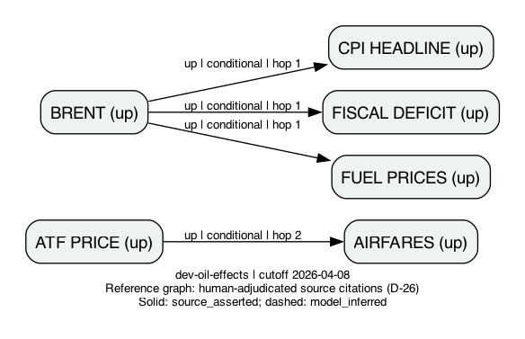

% Does Grounding Decay with Distance? Measuring and Repairing Weak Links in LLM Causal Explanations of Indian Macroeconomic News
% Language Models & Agents (LMA) Group Project 2026 - Final Report · 15 November 2026
% [GitHub submission branch](https://github.com/DeeptiKoranga/lma-grounding-decay/tree/b/episode-confirmation) · [Reproducibility README](https://github.com/DeeptiKoranga/lma-grounding-decay/blob/b/episode-confirmation/README.md)

## Abstract

We test whether causal links in model-generated explanations of Indian macro-financial news become less grounded farther from the queried event. We also test whether a graph-based verifier with targeted retrieval can reduce unsupported claims while retaining evidence-backed links. We ran seven conditions on four adjudicated development queries with two local models and on two held-out queries from a separate episode with the primary model. Relative to standard retrieval-augmented generation, the full system reduced the unsupported established-edge rate by 16.7 and 25.0 percentage points across the two development arms. On the held-out queries, the rate tied and reference-edge recall fell by 12.5 points. In a controlled challenge, semantic verification flagged 17 of 38 direction or strength corruptions that passed citation checks, with two false alarms among 23 clean controls. Deep-hop coverage was insufficient to assess grounding decay.

## 1. Introduction

A model explaining an oil shock might connect crude prices to aviation fuel costs and then to airfares. A citation can support one link while leaving the next unsupported. Even when the cited passage states the relation, the explanation may reverse its direction or present a conditional effect as certain. We use *grounding decay* to mean an increase in these errors with distance from the event. We evaluate whether publications available by the query cutoff state the claimed relations and preserve their degree of certainty. The study measures fidelity to those sources.

**RQ1.** In standard retrieval-augmented generation (RAG), do unsupported established edges and strength inflation become more common as links get farther from the event (H1)?

**RQ2.** Can the full graph-and-repair system cut the unsupported established-edge rate (UER) by at least 10 percentage points versus standard RAG (H2a), reduce the increase in errors at deeper hops (H2b), and improve on RAG prompted to label its own links for both UER and strength inflation (H2c)? A recall guard limits the acceptable loss in recovered reference edges to 10 points (H2d). The guard accounts for systems that lower their error rate by dropping recoverable claims.

<!-- pagebreak -->

## 2. Literature Review

Self-RAG learns when to retrieve and uses reflection tokens to critique generation [1]. FIRE interleaves retrieval and verification for individual fact-checking claims [2]. Our verifier judges a directed edge and its strength after checking source eligibility. CausalRAG uses causal graphs to organize retrieval [3]. In our evaluation the graph is an output, and hop distance within it defines which errors enter the grounding-decay analysis.

ReCEval assesses reasoning steps for correctness and informativeness [4]. We inspect individual links and derive a path label from the weakest link. Our causal-strength categories draw on Yu et al. [5]. We combine step-level evaluation with a publication cutoff and an explicit distinction between uncertain predictions and direct claims.

We pair unsupported-edge rate with reference recall to distinguish more precise claims from fewer claims. The design compares the full system against reranked retrieval and removes verification and targeted retrieval separately to test their contributions.

## 3. Dataset Created and Used

### 3.1 Corpus and evaluation sets

The frozen corpus contains **1,156 documents** (1,095 news and 61 official) and **16,472 passages** published from 1 March to 30 September 2026. Exact text hashes remove duplicates. For news, the deduplication step also checks title and first-paragraph word trigrams using MinHash and an exact Jaccard threshold of 0.85. Passage character offsets permit verbatim quotation checks. Six original-vintage series contribute 161 observations with availability dates. These series confirm whether a reported event crossed its threshold. Evidence for causal links comes from passages.

| Evaluation set | Size | Purpose |
|---|---:|---|
| Signed development | 4 queries, 16 edges | Gold-backed comparison across two model arms |
| Signed held-out | 2 queries, 8 edges | Descriptive comparison on a foreign portfolio investment (FPI) episode |
| Corruption challenge | 107 altered edges, 23 clean controls | Citation, direction and strength checks |
| Public diagnostics | 200 examples per task | Causal strength (Yu et al.) and detection (FinCausal) [6] |
| Action and safety diagnostics | 40 action states, 20 tool faults, 25 prompts | Tool selection, error recovery and safety checks |

<!-- pagebreak -->

### 3.2 Reference graphs

The split is by episode. Two further test candidates concerned Indian headline CPI and lacked sufficient eligible directed evidence for a signed graph. Two annotators independently reviewed the reference edges before reconciling disagreements. On development, they agreed on relation assertion for 16 of 20 drafts and on direction and strength for all 15 edges both retained. Reconciliation excluded four drafts for insufficient directional evidence. On held-out data, the reviewers agreed on relation and direction but disagreed on strength for seven of eight retained edges. Reconciliation assigned strength from the modality of the clause making the claim. Signed receipts bind the final graphs to the corpus and reference hashes.

The only timely passage pairing rate-hike expectations with headline CPI concerned US monetary policy. For the CPI effects question, most eligible passages treated Indian CPI as an outcome of the oil shock, leaving too little evidence of its downstream effects. We kept the FPI why and effects queries, both with an as-of date of 20 April 2026.

<!-- pagebreak -->

## 4. Methodology

### 4.1 Retrieve and extract

The input includes a query, an anchor event and an as-of date. BGE-M3 [7] retrieves date-eligible passages. The reranked baseline uses a cross-encoder to reorder the top 50 candidates before retaining the final eight. The generator organizes relations over a fixed ontology of 46 macro-financial variables. Each edge records its direction, evidence span, provenance and strength. Strength is direct, conditional or correlational. The output graph schema checks hop distance from the anchor. Path labels derive their strength from the weakest edge and report whether every link is sourced.

### 4.2 Verify and repair

The deterministic layer checks the passage ID, publication cutoff, mentions of both variables and a verbatim span. The semantic verifier reads the cited passage in a fresh context and assesses whether it states the proposed direction and how strongly it does so. Edges without supporting evidence remain inferred. This separation lets the system reject an invented citation without spending a semantic model call on it.

The controller verifies unchecked claims first, then searches for evidence on the highest-priority open edge. It stops when the important edges are resolved, when two searches add no new evidence candidates or when it reaches a 12-call budget. It can search the corpus, read series, verify a link, search for counterevidence, update the graph and stop. Tool schemas, date filters and budget checks constrain execution. Graph changes affect run state only. The prompts prohibit investment advice and model-generated forecasts.

### 4.3 Score explanations

UER divides unsupported established edges by all established edges. In prose outputs, cited or unhedged claims count as established. Strength inflation is the share of supported established edges whose label is stronger than the cited source warrants. Reference recall is the fraction of signed edges recovered by supported, established predictions matching the source variable, target variable and direction.

We compute each metric per query. A paired contrast averages the within-query differences over queries with a defined score for both conditions. A query with no established edges has undefined UER, so it cannot improve the paired average by contributing zero. The predeclared trend rule requires at least ten established edges in each of the hop 1, hop 2 and hop 3+ buckets. Inferential claims require ten queries.

<!-- pagebreak -->

## 5. Experiment Runs

**Model pilot.** The two checkpoints tied at 61.0% on a 100-item pilot covering extraction, strength, JSON validity, tool choice and unsupported-edge detection. The predeclared latency tiebreak selected Qwen3-8B at 20.4 seconds per case versus 26.6 seconds for Qwen3.5-9B. Yet the selected model produced only 1/20 strictly correct extractions, compared with 13/20 for the sensitivity model. This matters because the verifier can judge a claim only after the generator has supplied an eligible citation.

| Run | Scope | Model or comparison |
|---|---|---|
| Primary development sweep | 28 graphs, 4 signed queries x 7 conditions | Qwen3-8B, 4-bit, revision `545dc425` |
| Sensitivity development sweep | 28 graphs, same queries and conditions | Qwen3.5-9B, 4-bit, revision `8b2b98c` |
| Primary held-out sweep | 14 graphs, 2 signed FPI queries x 7 conditions | Same pinned primary model and retriever |
| Retrieval evaluation | 20 pilot queries and 2 signed FPI queries | Sparse, dense, hybrid and reranked retrieval |
| Challenge and capability runs | Corruptions, public data, scripted states and faults | Rules, model and controller diagnostics |

Development generation used 185 completed model calls and 116.1 minutes of summed model-call wall time on local MLX. Held-out generation used 34 model calls and 74 tool calls, taking 38.2 minutes of summed per-graph time. All 14 held-out runs confirmed their anchors, and all 121 logged passage occurrences met the cutoff. A separate Kaggle run used 1.211 allocated GPU-hours. The models were used without fine-tuning or paid API calls. [Compute accounting](https://github.com/DeeptiKoranga/lma-grounding-decay/blob/b/episode-confirmation/reports/compute_log.md) · [Held-out run audit](https://github.com/DeeptiKoranga/lma-grounding-decay/blob/b/episode-confirmation/reports/heldout_generation_20261112.md)

The repository README gives fresh-clone setup and test commands. Full experiment reproduction requires the pinned model revisions and a separately provisioned corpus and dense index. [Reproducibility README](https://github.com/DeeptiKoranga/lma-grounding-decay/blob/b/episode-confirmation/README.md) · [Experiment reproduction](https://github.com/DeeptiKoranga/lma-grounding-decay/blob/b/episode-confirmation/docs/reproduction.md)

<!-- pagebreak -->

## 6. Ablations

| Condition | Role in the comparison |
|---|---|
| B0 | Query-only baseline, no text retrieval |
| B1 | Standard RAG, prose with citations |
| B1-R | RAG plus a top-50 cross-encoder reranker |
| B2 | RAG with prompted provenance and strength labels |
| A-NoVerify | Full system with generator self-labels replacing semantic verification |
| A-NoLoop | Full system with initial retrieval only and no targeted search loop |
| M | Full graph, verifier and search loop |

Within an arm, conditions share the model, query, corpus and cutoff. Where retrieval is used, the first-stage retriever is shared. The following comparisons use the historical development labels described in Section 7.1. A negative number means the first condition has fewer unsupported established edges, in percentage points. Parentheses give the number of usable query pairs.

| Paired UER contrast | Primary development | Sensitivity development |
|---|---:|---:|
| B1-R minus B1 | -33.3 (3) | -9.2 (4) |
| M minus B1-R | 0.0 (4) | -12.5 (2) |
| M minus B2 | -25.0 (4) | -62.5 (2) |
| M minus A-NoVerify | -20.8 (4) | -62.5 (2) |
| M minus A-NoLoop | +50.0 (1) | Unavailable (0) |

Reranking alone reduced development UER, and it matched the full system's primary UER and reference recall. The verifier ablation and the comparison with prompted self-labels favour M on UER, but there are no usable paired strength-inflation values for H2c. The no-loop condition established too few links to assess the effect of targeted retrieval.

<!-- pagebreak -->

## 7. Evaluations

### 7.1 Grounding and reference recall

The original development scores used 24 assistant-produced prose corrections and 247 assistant-produced support labels. Those scores supply the exploratory ablation table. In a separate human-blind validation sample, 13 of 40 items had no evidence span and could only be marked unsupported. On the 27 informative rows, agreement was **21/27 (77.8%, Cohen's kappa 0.560)**. In five of the six disagreements the assistant credited support the human rejected. This could understate development UER, particularly in the sensitivity arm, where all six disagreements occurred. [Original scoring record](https://github.com/DeeptiKoranga/lma-grounding-decay/blob/b/episode-confirmation/reports/assistant_dev_support_review_20261110.md) · [Blind sample report](https://github.com/DeeptiKoranga/lma-grounding-decay/blob/b/episode-confirmation/reports/support_sample_validation.md)

For the revised scores, one author of this report reviewed 30 prose answers, approved 27 extraction revisions and authored all 291 support judgments, attesting to blinding and independence. The returned files passed packet coverage, checksum and scoring checks. These labels were produced by an author of the system under test, which is why the held-out result below is weighed against the blind sample rather than on its own. The table reports M minus standard RAG (B1) in percentage points. Parentheses give the number of usable pairs.

| Revised evaluation | Edge judgments | UER difference | Reference recall difference |
|---|---:|---:|---:|
| Primary development | 122 | -16.7 (3) | +6.25 (4) |
| Sensitivity development | 114 | -25.0 (2) | 0.0 (4) |
| Primary held-out | 55 | 0.0 (2) | -12.5 (2) |

Both development arms met the H2a target and the H2d recall guard descriptively. **On the held-out queries H2d fails.** On the held-out queries, M matched B1’s mean UER and missed the recall guard by 2.5 points: there was no error reduction to pay for the 12.5-point recall loss, which is the pattern the guard was written to catch. The breach is descriptive given the query count, but the development half where the guard holds rests on labels an author of the system produced, while the only blind-validated evidence is the 40-row sample. Query counts fell below the threshold for inference.

In the original [primary](rq1_hop_decay.md) and [sensitivity](rq1_hop_decay_sensitivity.md) analyses, B1 produced 5/2/1 and 13/1/0 established edges at hops 1/2/3+, respectively. Neither arm met the ten-edge minimum in all three buckets, leaving H1 unresolved. H2b also lacked usable shallow-to-deep query pairs. The exploratory H2c comparison favored M on UER but lacked a usable paired strength-inflation estimate.

<!-- pagebreak -->

### 7.2 Retrieval

The pilot used 2,035 automated relevance judgments for development selection. BGE-M3 led the unreranked configurations. The cross-encoder improved all three pilot metrics, but retrieved fewer signed passages on the two held-out queries. For the FPI why query, reranking moved the first signed passage from rank six to rank nineteen. Neither configuration found signed evidence in the top 50 for the effects query.

| Split and retriever | Recall@5 | Recall@10 | MRR@50 |
|---|---:|---:|---:|
| Pilot BM25 | 0.2405 | 0.3518 | 0.4555 |
| Pilot BGE-M3 | 0.3327 | 0.4259 | 0.6981 |
| Pilot BGE-M3 + reranker | 0.4072 | 0.5296 | 0.7101 |
| Held-out BGE-M3 | 0.000 | 0.250 | 0.083 |
| Held-out BGE-M3 + reranker | 0.000 | 0.000 | 0.026 |

### 7.3 Corruption challenge

| Challenge item | Items | Flagged by rules | Flagged by semantic check |
|---|---:|---:|---:|
| Citation corruptions (hop, date or target) | 69 | 69 | Filtered upstream |
| Reversed relations | 23 | 0 | 9 |
| Inflated strength | 15 | 0 | 8 |
| Clean controls | 23 | 0 | 2 false alarms |

We count a reversal as detected when the verifier declines to mark the edge source-asserted. We count strength inflation as detected when it returns a weaker label than the claimed strength. The verifier also disagreed with the reference strength on 8 of 23 clean controls. Those disagreements qualify the strength result and are tracked separately from the two provenance false alarms in the table. Some test references seeded this controlled diagnostic.

**Failure example.** In the development query on rupee pressure, the verifier-free condition reversed a relation from oil risk to rupee pressure. A quotation from the relevant passage can still mention both variables in the reversed edge. This explains why the direction test adds information to the citation-integrity checks.

<!-- pagebreak -->

### 7.4 Reasoning diagnostics

On the primary development run, M had direction accuracy of 1.000 and strength macro-F1 of 0.455 over six matched reference pairs. B1 reached 1.000 and 0.678 over nine. These scores describe only the reference pairs each condition found. On the historical primary scores, provenance accuracy was 0.750 for M and 0.396 for A-NoVerify. A fixed synthetic check reproduced weakest-hop labels on all three paths. Strict path validity, which also requires support and no inflation on each link, was 0.083 for M and 0.125 for B1-R.

The public-data runs compared Qwen3-8B with a cue-list baseline on 200 frozen examples per task. These classification tests isolate causal wording and do not test direction or the accuracy of a retrieved citation.

| Public diagnostic | Cue baseline | Qwen3-8B |
|---|---:|---:|
| Causal-strength macro-F1 (Yu et al.) | 0.414 | 0.478 |
| Causal detection F1 (FinCausal) | 0.497 | 0.549 |

### 7.5 Agentic control and tool use

On 40 scripted states, the standalone model selected the expected action in 5/40, returned valid arguments and an unchanged cutoff in 34/40, and proposed an unsafe call in 11/40 when budget was also checked. It proposed a call in all five zero-budget states. The deployed controller uses deterministic priorities and enforces the budget before execution. Tool-fault recovery passed all 20 scripted cases. An assistant-reviewed screen of 25 adversarial prompts found no investment advice, model-generated forecasts or post-cutoff evidence use. An automated check flagged four possible missing-span assertions for separate review.

| Development run | Mean calls per query | Redundant searches | Unchecked edges at stop |
|---|---:|---:|---:|
| Primary M | 12.0 | 0/13 | 13 |
| Sensitivity M | 12.0 | 0/12 | 12 |
| Primary A-NoVerify | 6.0 | 4/13 | 7 |
| Sensitivity A-NoVerify | 3.5 | 0/6 | 0 |

M exhausted its budget and stopped with unchecked edges on every development query. A search is redundant when it returns no new passage ID. A new ID can still be irrelevant to the edge under repair. The rate is unavailable for conditions that retrieve only once.

<!-- pagebreak -->

## 8. Limitations

**Sample size and coverage.** The design targeted 24 signed test queries, with a fallback of 16. The final set contains two from one episode. The signed graphs cover hops 1 and 2 only. About 79% of the news documents come from one publisher, and three ontology variables never match their pinned aliases in the corpus. These constraints particularly limit the long paths that would test grounding decay. All 56 historical development artifacts also lacked runtime confirmation windows. Their date filters still ran, and the later held-out runs confirmed anchors using explicit thresholds.

**Extraction and evidence quality.** The selected generator cited the wrong passage on 17 of 20 pilot items. In one development case, A-NoVerify reused a single paragraph for six established claims that the paragraph did not state. The verifier can filter these claims, but the recall loss and unresolved edge queue show what happens when it cannot recover evidence within budget. Strength labels are also sensitive to whether a reviewer reads the mechanism or the qualifier in the clause that asserts it.

**Follow-up.** The next evaluation should broaden the signed test set across episodes, include reference chains beyond hop 2 and fix the experimental inputs before scoring. Citation extraction and the search priority policy are candidates for a separate intervention. Evaluating those changes against reranked RAG with the same recall guard would distinguish recovery of valid evidence from rejection of unsupported claims.

## 9. Conclusions

The controlled challenge shows that semantic verification can detect direction and strength errors that pass citation checks. The development results favor the full system on unsupported-edge rate, but the two held-out queries tied standard RAG on that measure and missed the recall guard. With few deeper links, the study leaves grounding decay unresolved. A larger, episode-diverse test should measure whether semantic verification improves grounding while preserving recall.

## 10. References

1. A. Asai, Z. Wu, Y. Wang, A. Sil, and H. Hajishirzi. [Self-RAG: Learning to Retrieve, Generate, and Critique through Self-Reflection](https://openreview.net/forum?id=hSyW5go0v8). *ICLR*, 2024.
2. Z. Xie, R. Xing, Y. Wang, J. Geng, H. Iqbal, D. Sahnan, I. Gurevych, and P. Nakov. [FIRE: Fact-checking with Iterative Retrieval and Verification](https://aclanthology.org/2025.findings-naacl.158/). *Findings of NAACL*, 2025.
3. N. Wang, X. Han, J. Singh, J. Ma, and V. Chaudhary. [CausalRAG: Integrating Causal Graphs into Retrieval-Augmented Generation](https://aclanthology.org/2025.findings-acl.1165/). *Findings of ACL*, 2025.
4. A. Prasad, S. Saha, X. Zhou, and M. Bansal. [ReCEval: Evaluating Reasoning Chains via Correctness and Informativeness](https://aclanthology.org/2023.emnlp-main.622/). *EMNLP*, 2023.
5. B. Yu, Y. Li, and J. Wang. [Detecting Causal Language Use in Science Findings](https://aclanthology.org/D19-1473/). *EMNLP-IJCNLP*, 2019.
6. D. Mariko, H. Abi-Akl, E. Labidurie, S. Durfort, H. De Mazancourt, and M. El-Haj. [The Financial Document Causality Detection Shared Task (FinCausal 2020)](https://aclanthology.org/2020.fnp-1.3/). *Financial Narrative Processing Workshop*, 2020.
7. J. Chen, S. Xiao, P. Zhang, K. Luo, D. Lian, and Z. Liu. [M3-Embedding: Multi-Linguality, Multi-Functionality, Multi-Granularity Text Embeddings Through Self-Knowledge Distillation](https://aclanthology.org/2024.findings-acl.137/). *Findings of ACL*, 2024.
